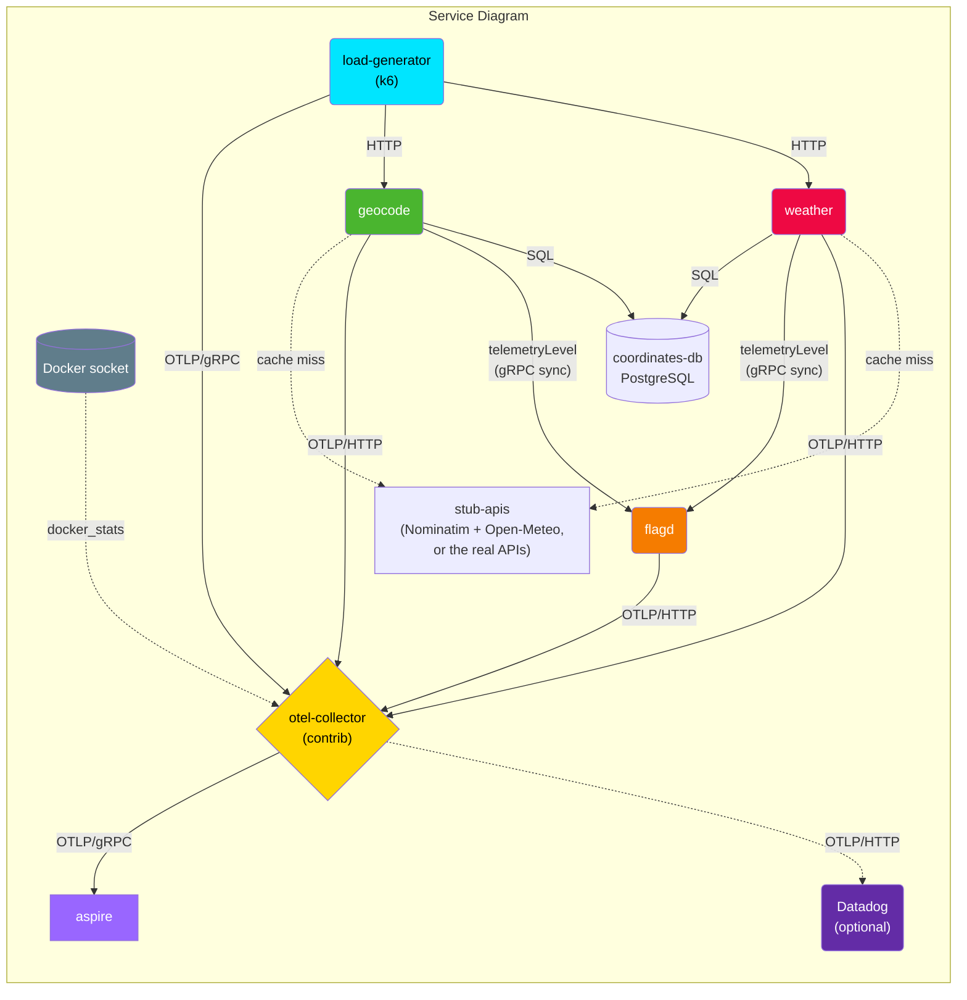

# poc-otelfeature

A proof-of-concept sandbox for exploring OpenTelemetry instrumentation:
a Python geocoding API, a Java weather API, an OpenTelemetry Collector,
and an [Aspire Dashboard](https://learn.microsoft.com/en-us/dotnet/aspire/fundamentals/dashboard/overview)
to visualize the resulting traces, metrics, and logs.

## Architecture



- **geocode** ([src/geocode](src/geocode)) — a FastAPI service that resolves
  a city/country to latitude/longitude. It checks `coordinates-db` first; on
  a cache miss it falls back to the
  [Nominatim](https://nominatim.org/release-docs/latest/api/Search/) API and
  persists the result for next time. Runs under
  [otelfeature-instrument](https://github.com/OTelFeature/otelfeature-instrument),
  a separate, reusable zero-code launcher that also suppresses `INTERNAL`
  spans live, controlled by the `telemetryLevel` flag served from `flagd`.
- **flagd** ([src/flagd](src/flagd)) — an [OpenFeature](https://openfeature.dev/)
  flag backend serving the `telemetryLevel` flag that controls both
  `geocode`'s and `weather`'s trace verbosity (via `otelfeature-instrument`
  and `otelfeature-java-extension` respectively), editable live with no
  restart.
- **weather** ([src/weather](src/weather)) — a Java/Spring Boot service that
  resolves current weather for a city/country pair. It checks the `weather`
  cache table in `coordinates-db` first; on a miss it looks up coordinates
  (from the `coordinates` table shared with `geocode`, or Open-Meteo's
  geocoding API as fallback), queries the
  [Open-Meteo](https://open-meteo.com/) forecast API, and persists the result.
  Instrumented with the [OpenTelemetry Java auto-instrumentation
  agent](https://github.com/open-telemetry/opentelemetry-java-instrumentation)
  — zero-code `-javaagent` instrumentation of Spring Boot, JDBC, and
  `java.net.http.HttpClient`. Also uses
  [otelfeature-java-extension](https://github.com/OTelFeature/otelfeature-java-extension)
  for flagd-controlled `INTERNAL`-span suppression (the Java counterpart to
  `otelfeature-instrument`). Like `geocode`, it syncs the flag ruleset
  in-process from flagd over the gRPC sync stream, so a flag edit takes effect
  on the very next span.
- **coordinates-db** ([src/coordinates-db](src/coordinates-db)) — a Postgres
  instance caching previously resolved city/country → lat/lon lookups (shared
  by `geocode` and `weather`) and weather results, so repeat requests don't
  hit external APIs.
- **stub-apis** ([src/stub-apis](src/stub-apis)) — an offline stand-in for
  Nominatim and Open-Meteo, so the stack runs with no network. `make start`
  points both services at it; `make start-live` uses the real APIs.
- **load-generator** ([src/load-generator](src/load-generator)) — a k6 script
  that continuously sends requests to both `geocode` (`POST /geocode`) and
  `weather` (`POST /weather`), exporting its own metrics to the collector
  over OTLP/gRPC.
- **otel-collector** ([src/otel-collector](src/otel-collector)) — an
  `opentelemetry-collector-contrib` instance that receives OTLP from the
  services, also scrapes Docker container stats, derives span metrics, and
  forwards everything to the Aspire Dashboard — and, optionally, to Datadog.
- **aspire-dashboard** — Microsoft's Aspire Dashboard, used here purely as a
  local OTLP viewer/UI.

> [!NOTE]
> `geocode`'s telemetry bootstrap (`opentelemetry-instrument`-style zero-code
> launcher, plus the flagd-controlled `INTERNAL`-span suppression) has moved
> out of this repo into
> [OTelFeature/otelfeature-instrument](https://github.com/OTelFeature/otelfeature-instrument),
> a standalone, reusable dependency any Python service can adopt — not just
> `geocode`. `src/geocode` pulls it in as a regular (if not-yet-published)
> dependency; see [geocode's README](src/geocode/README.md#dependencies).
>
> `weather` uses the Java counterpart,
> [OTelFeature/otelfeature-java-extension](https://github.com/OTelFeature/otelfeature-java-extension),
> an OTel Java agent extension JAR that adds the same flagd-controlled
> `INTERNAL`-span suppression. The JAR is downloaded from
> [GitHub Releases](https://github.com/OTelFeature/otelfeature-java-extension/releases)
> during the Docker build. See
> [weather's README](src/weather/README.md#otelfeature-java-extension) for details.
>
> Both services now talk to flagd the same way — the in-process resolver on
> the gRPC sync port `8015` — and both evaluate `telemetryLevel` only as often
> as the flag actually requires: once while it is static, per span once it
> carries a `targeting` block. See [flagd's README](src/flagd/README.md).

## Requirements

- Docker and Docker Compose
- [uv](https://docs.astral.sh/uv/) (only needed for local, non-container
  development of `geocode`)

## Running

```sh
make build            # docker compose build
make start            # docker compose up -d, external APIs stubbed
make start-live       # same, but geocode/weather call the real Nominatim and Open-Meteo
make prepare-offline  # pull + build everything, so `make start` later needs no network
make stop             # docker compose down
```

Once started:

- Aspire Dashboard: http://localhost:18888
- Geocode health check: http://localhost:8000/health
- Weather health check: http://localhost:8001/health

Example requests:

```sh
# Geocode — resolve city/country to lat/lon
curl -s -X POST http://localhost:8000/geocode \
  -H "Content-Type: application/json" \
  -d '{"city": "linz", "country": "austria"}'

# Weather — get current weather for a city/country
curl -s -X POST http://localhost:8001/weather \
  -H "Content-Type: application/json" \
  -d '{"city": "linz", "country": "austria"}'
```

### Running on stage

The default stack needs no network once its images exist. `geocode` and
`weather` call [stub-apis](src/stub-apis) instead of Nominatim and Open-Meteo,
and nothing else in the stack needs to reach outside the compose network.
One exception: the collector's optional Datadog exporter is always in the
pipelines and, without `DD_SITE`/`DD_API_KEY`, logs export errors (which
also show up in Aspire as collector logs). Ignore them.

1. While online: `make prepare-offline`. This pulls every image and builds
   `geocode` and `weather` (their builds download dependencies, the OTel Java
   agent and the otelfeature extension, so they can't run offline).
2. Offline: `make start`. It never rebuilds on its own; don't run
   `make build` or `docker compose up --build` without network.

The outgoing `CLIENT` spans still show a real HTTP call, with
`server.address` = `stub-apis` and 20–120 ms of latency. They only appear on
a cache miss, and the Postgres volume survives `make stop`. To show them
again after a rehearsal, start from an empty cache with
`docker compose down -v`.

To demo against the real APIs instead, use `make start-live` (and keep the
request rate within
[Nominatim's usage policy](https://operations.osmfoundation.org/policies/nominatim/)).
Live mode lasts only for that invocation: a later `make start` or
`docker compose up -d <service>` recreates the services with the stub URLs.
To make it stick, put `NOMINATIM_URL`, `OPEN_METEO_GEOCODING_URL` and
`OPEN_METEO_FORECAST_URL` in `.env` (gitignored).

Each service has its own README with configuration details:
[geocode](src/geocode/README.md), [weather](src/weather/README.md),
[flagd](src/flagd/README.md), [coordinates-db](src/coordinates-db/README.md),
[load-generator](src/load-generator/README.md),
[stub-apis](src/stub-apis/README.md),
[otel-collector](src/otel-collector/README.md).

## Repository layout

```
compose.yaml              # service definitions and wiring
Makefile                  # build/start/stop shortcuts around docker compose
src/
  geocode/                # FastAPI geocoding service (uv + Docker)
  weather/                # Java/Spring Boot weather service (Gradle + Docker)
  flagd/                  # OpenFeature flag definitions (flagd)
  coordinates-db/         # Postgres init script (coordinates + weather cache)
  load-generator/         # k6 load test script targeting geocode and weather
  stub-apis/              # offline stand-in for Nominatim and Open-Meteo
  otel-collector/         # collector config.yaml
```

> [!NOTE]
> This note is about `make start-live`; the default `make start` talks to
> `stub-apis`, which has no rate limit.
> `geocode` caches resolved coordinates in `coordinates-db`, so only
> first-time city/country lookups hit Nominatim. `weather` similarly caches
> weather results and shares the `coordinates` table with `geocode`, so only
> first-time lookups hit [Open-Meteo](https://open-meteo.com/) (which has no
> API key and generous rate limits). `load-generator`'s default rate is still
> deliberately low (1 request every 5s per service) to stay well under
> [Nominatim's usage policy](https://operations.osmfoundation.org/policies/nominatim/)
> for whatever does miss the cache — raise `REQUEST_INTERVAL_SECONDS` at your
> own risk of getting rate-limited (HTTP 429).

> [!NOTE]
> Forwarding telemetry to Datadog (`otel-collector`'s `otlp_http/datadog`
> exporter) is optional and off by default — see
> [otel-collector's README](src/otel-collector/README.md#datadog-export).
