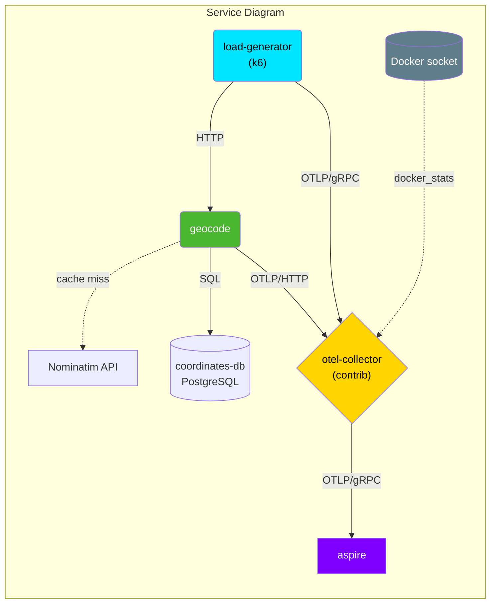

# poc-otelfeature

A proof-of-concept sandbox for exploring OpenTelemetry instrumentation:
a small Python API service, an OpenTelemetry Collector, and an
[Aspire Dashboard](https://learn.microsoft.com/en-us/dotnet/aspire/fundamentals/dashboard/overview)
to visualize the resulting traces, metrics, and logs.

## Architecture



- **geocode** ([src/geocode](src/geocode)) — a FastAPI service that resolves
  a city/country to latitude/longitude. It checks `coordinates-db` first; on
  a cache miss it falls back to the
  [Nominatim](https://nominatim.org/release-docs/latest/api/Search/) API and
  persists the result for next time. Auto-instrumented with
  `opentelemetry-distro`, exporting traces/metrics/logs over OTLP/HTTP.
- **coordinates-db** ([src/coordinates-db](src/coordinates-db)) — a Postgres
  instance caching previously resolved city/country → lat/lon lookups, so
  repeat requests don't hit Nominatim's rate limit.
- **load-generator** ([src/load-generator](src/load-generator)) — a k6 script
  that continuously sends `POST /geocode` requests to `geocode`, exporting its
  own metrics to the collector over OTLP/gRPC.
- **otel-collector** ([src/otel-collector](src/otel-collector)) — an
  `opentelemetry-collector-contrib` instance that receives OTLP from the
  services, also scrapes Docker container stats, derives span metrics, and
  forwards everything to the Aspire Dashboard.
- **aspire-dashboard** — Microsoft's Aspire Dashboard, used here purely as a
  local OTLP viewer/UI.

## Requirements

- Docker and Docker Compose
- [uv](https://docs.astral.sh/uv/) (only needed for local, non-container
  development of `geocode`)

## Running

```sh
make build   # docker compose build
make start   # docker compose up -d
make stop    # docker compose down
```

Once started:

- Aspire Dashboard: http://localhost:18888
- Geocode health check: http://localhost:8000/health

Example request:

```sh
curl -s -X POST http://localhost:8000/geocode \
  -H "Content-Type: application/json" \
  -d '{"city": "linz", "country": "austria"}'
```

Each service has its own README with configuration details:
[geocode](src/geocode/README.md), [coordinates-db](src/coordinates-db/README.md),
[load-generator](src/load-generator/README.md),
[otel-collector](src/otel-collector/README.md).

## Repository layout

```
compose.yaml              # service definitions and wiring
Makefile                  # build/start/stop shortcuts around docker compose
src/
  geocode/                # FastAPI geocoding service (uv + Docker)
  coordinates-db/         # Postgres init script (coordinates cache)
  load-generator/         # k6 load test script targeting geocode
  otel-collector/         # collector config.yaml
```

> [!NOTE]
> `geocode` caches resolved coordinates in `coordinates-db`, so only
> first-time city/country lookups hit Nominatim. `load-generator`'s default
> rate is still deliberately low (1 request every 5s) to stay well under
> [Nominatim's usage policy](https://operations.osmfoundation.org/policies/nominatim/)
> for whatever does miss the cache — raise `REQUEST_INTERVAL_SECONDS` at your
> own risk of getting rate-limited (HTTP 429).
