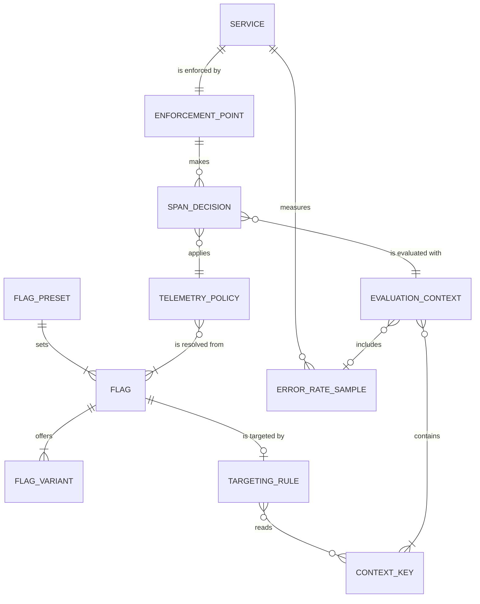

# Entity Model

Elaboration artifact, derived from [requirements.md](requirements.md).

This is not a database schema. The entities are the things the specs talk
about: flags, the policy resolved from them, the evaluation context, and where
the decision is enforced. Attribute tables use AIUP's closed data-type and
validation vocabulary. Three things AIUP's entity format has no place for
are added after the entities as **reference data**: the concrete flags, the
evaluation-context contract, and the enforcement points. Those tables are the
contract the code is checked against.

## Entity Relationship Diagram

### FLAG

An OpenFeature flag served by flagd from `src/flagd/flagd.json`.

| Attribute | Description | Data Type | Length/Precision | Validation Rules |
|---|---|---|---|---|
| key | Flag key as used by the SDKs | String | 100 | Not Null, Unique |
| valueType | Type of the variant values | String | 10 | Not Null, Values: boolean, string, number |
| defaultVariant | Variant served when no targeting rule matches | String | 50 | Not Null |
| state | flagd flag state | String | 10 | Not Null, Values: ENABLED, DISABLED |
| description | One-line purpose | String | 500 | Optional |
| consumer | Who evaluates it | String | 20 | Not Null, Values: extension, application |

### FLAG_VARIANT

One named value of a flag.

| Attribute | Description | Data Type | Length/Precision | Validation Rules |
|---|---|---|---|---|
| flagKey | Owning flag | String | 100 | Not Null, Foreign Key (FLAG.key) |
| name | Variant name in `flagd.json` | String | 50 | Not Null |
| value | Variant value, serialized | String | 100 | Not Null |

**Constraints:** (flagKey, name) unique.

### TARGETING_RULE

The flagd JsonLogic `targeting` block of a flag. Its presence switches the
extensions from the static fast path to per-span evaluation (NFR-003).

| Attribute | Description | Data Type | Length/Precision | Validation Rules |
|---|---|---|---|---|
| flagKey | Flag the rule belongs to | String | 100 | Not Null, Foreign Key (FLAG.key) |
| expression | JsonLogic expression returning a variant name | String | 4000 | Not Null |
| usesSpanKeys | Whether the rule reads span-level context keys (decides whether Python can decide per tracer, OTelFeature/poc#12) | Boolean | 1 | Not Null |

### FLAG_PRESET

A named, complete `flagd.json` for one stage state (OTelFeature/poc#26).

| Attribute | Description | Data Type | Length/Precision | Validation Rules |
|---|---|---|---|---|
| name | Preset name, also the file name in `src/flagd/presets/` | String | 50 | Not Null, Unique |
| scriptBeat | Talk beat the preset belongs to | String | 100 | Not Null |
| schemaValid | Validates against `https://flagd.dev/schema/v0/flags.json` | Boolean | 1 | Not Null |

### TELEMETRY_POLICY

The single value an enforcement point reads per decision (OTelFeature/poc#9).
Every field defaults to the value derived from the startup env vars, so a
missing or broken flag means stock OTel behaviour (NFR-001).

| Attribute | Description | Data Type | Length/Precision | Validation Rules |
|---|---|---|---|---|
| enabled | Spans are created at all. `false` when `otelEnabled=false` or `telemetryLevel=OFF` (D2) | Boolean | 1 | Not Null |
| suppressInternal | `INTERNAL` spans are dropped. `true` when `telemetryLevel=IO` | Boolean | 1 | Not Null |
| sampleRatio | Root-span sample ratio from `traceSampleRatio` | Decimal | 5,4 | Not Null, Min: 0.0, Max: 1.0 |
| static | All flags read resolved with reason `STATIC`, so the policy is cached for the process | Boolean | 1 | Not Null |
| decidingFlagKey | Flag whose non-default value produced this policy, if any (for FR-014) | String | 100 | Optional |
| decidingVariant | Variant of that flag | String | 50 | Optional |

### SERVICE

An instrumented process, identified by its OTel resource.

| Attribute | Description | Data Type | Length/Precision | Validation Rules |
|---|---|---|---|---|
| serviceName | `service.name` | String | 100 | Not Null |
| serviceNamespace | `service.namespace` | String | 100 | Optional |
| serviceVersion | `service.version` | String | 50 | Optional |
| deploymentEnvironment | `deployment.environment.name`, set by the service, not the collector (OTelFeature/poc#25) | String | 20 | Optional, Values: production, staging |
| language | `telemetry.sdk.language` | String | 10 | Not Null, Values: python, java |

**Constraints:** (serviceName, deploymentEnvironment) unique.

### ENFORCEMENT_POINT

Where a service applies the policy to a span. See the reference table below.

| Attribute | Description | Data Type | Length/Precision | Validation Rules |
|---|---|---|---|---|
| name | Enforcement point name | String | 50 | Not Null, Unique |
| language | Extension language | String | 10 | Not Null, Values: python, java |
| decidesAt | When the decision is taken | String | 20 | Not Null, Values: before-create, on-start |
| savesServiceCpu | Dropped spans are never created or populated | Boolean | 1 | Not Null |
| mode | Value of `OTELFEATURE_ENFORCEMENT` that selects it (Java only) | String | 10 | Optional, Values: sampler, processor |

### EVALUATION_CONTEXT

What a targeting rule sees for one decision. Built only when the policy is not
static (NFR-003). Resource keys and the error rate form a pre-built base
context; scope and span keys are merged per span.

| Attribute | Description | Data Type | Length/Precision | Validation Rules |
|---|---|---|---|---|
| targetingKey | Trace id, hex, so `fractional` buckets a trace the same in every service | String | 32 | Not Null, Format: 32 lower-case hex characters |
| shape | How dotted semconv names are represented (OQ-2, OTelFeature/poc#22) | String | 10 | Not Null, Values: nested, flat |

### CONTEXT_KEY

One key of the evaluation-context contract.

| Attribute | Description | Data Type | Length/Precision | Validation Rules |
|---|---|---|---|---|
| name | Semconv attribute name | String | 100 | Not Null, Unique |
| source | Where the value comes from | String | 20 | Not Null, Values: resource, scope, span-start, metric, trace |
| dataType | Value type | String | 10 | Not Null, Values: string, number |
| knownAtStart | Available when the span starts (C-003) | Boolean | 1 | Not Null |

### ERROR_RATE_SAMPLE

One collection of the in-process delta metric reader (FR-011, decision D5).

| Attribute | Description | Data Type | Length/Precision | Validation Rules |
|---|---|---|---|---|
| serviceName | Service that recorded the metric | String | 100 | Not Null |
| collectedAt | Collection time | DateTime | | Not Null |
| totalCount | Sum of `http.server.request.duration` point counts in the interval | Long | 19 | Not Null, Min: 0, Max: 9223372036854775807 |
| errorCount | Sum of counts of points with `error.type` set (Python fallback: status >= 500) | Long | 19 | Not Null, Min: 0, Max: 9223372036854775807 |
| errorRate | errorCount / totalCount; absent when totalCount is 0 | Decimal | 5,4 | Optional, Min: 0.0, Max: 1.0 |

### SPAN_DECISION

The outcome for one span start.

| Attribute | Description | Data Type | Length/Precision | Validation Rules |
|---|---|---|---|---|
| outcome | What happens to the span | String | 10 | Not Null, Values: RECORD, DROP, DELEGATE |
| spanKind | Kind of the span asked about | String | 10 | Not Null, Values: server, client, producer, consumer, internal |
| isRoot | Span has no valid local or remote parent | Boolean | 1 | Not Null |
| appliedSampleRatio | Ratio used, recorded on kept root spans as `otelfeature.sample_ratio` (FR-014) | Decimal | 5,4 | Optional, Min: 0.0, Max: 1.0 |

## Reference data

### Flags

| Key | Type | Variants | Default | Consumer | Status | Issue |
|---|---|---|---|---|---|---|
| `otelEnabled` | boolean | `on`=true, `off`=false | `on` | extension | planned | OTelFeature/poc#8 |
| `telemetryLevel` | string | `full`=FULL, `io`=IO, `off`=OFF | `full` | extension | FULL/IO exist; OFF planned | OTelFeature/poc#8 |
| `traceSampleRatio` | number | e.g. `all`=1.0, `tenth`=0.1, `none`=0.0 | `all` | extension | planned | OTelFeature/poc#10 |
| `weatherUpstreamFailure` | number | e.g. `none`=0.0, `incident`=0.3 | `none` | application (`weather`) | planned | OTelFeature/poc#28 |
| `signalsEnabled` | object | per signal | all on | extension | deferred, out of scope | OTelFeature/poc#11 |

Variant names other than the existing `full`/`io` are suggestions; the issue
that adds the flag fixes them.

Flag key for the Java extension's main flag is configurable with
`OTELFEATURE_FLAG_NAME` (default `telemetryLevel`). Python's is fixed.

### Policy field resolution

| Field | From flags | Startup default (flag missing or broken) |
|---|---|---|
| `enabled` | `otelEnabled != false` and `telemetryLevel != OFF` | `true` (stock SDK; `OTEL_SDK_DISABLED` keeps its stock meaning at startup) |
| `suppressInternal` | `telemetryLevel == IO` | `false` |
| `sampleRatio` | `traceSampleRatio`, clamped to 0.0..1.0; non-numeric falls back | `OTEL_TRACES_SAMPLER_ARG` when the configured sampler is ratio-based, else 1.0 |

Unknown `telemetryLevel` values resolve to `FULL` (existing behaviour, kept).

### Evaluation-context contract

Shape (nested objects vs flat dotted keys) is pending OTelFeature/poc#22
(OQ-2). The expected outcome is nesting by dot segment, `service.name` →
`{"service": {"name": ...}}`.

| Key | Source | Type | Known at start | Notes |
|---|---|---|---|---|
| `targetingKey` | trace | string | yes | Trace id (hex). Python roots: the id must exist before evaluation and be kept by the span |
| `service.name` | resource | string | yes | |
| `service.namespace` | resource | string | yes | |
| `service.version` | resource | string | yes | |
| `deployment.environment.name` | resource | string | yes | Must be set by the service (OTelFeature/poc#25) |
| `telemetry.sdk.language` | resource | string | yes | |
| `otel.scope.name` | scope | string | yes | Python: `instrumenting_module_name`; Java: `InstrumentationScopeInfo` name |
| `otel.scope.version` | scope | string | yes | |
| `span.kind` | span-start | string | yes | Lower-case semconv value |
| `span.name` | span-start | string | yes | |
| `url.path` | span-start | string | if set | Use instead of `http.route` (D6) |
| `http.request.method` | span-start | string | if set | |
| `server.address` | span-start | string | if set | |
| `db.system.name` | span-start | string | if set | Marks DB client leaf spans |
| `db.operation.name` | span-start | string | if set | |
| `rpc.service` | span-start | string | if set | |
| `otelfeature.http.server.error_rate` | metric | number | yes | Absent when the last interval had no requests (FR-011) |
| `http.route` | span-end | - | **no** | Not available; do not write rules on it |
| `http.response.status_code` | span-end | - | **no** | Not available; do not write rules on it |

### Enforcement points

| Name | Language | Decides at | Saves service CPU | Can drop | Today |
|---|---|---|---|---|---|
| Tracer wrapper (`_VerbosityAwareTracer`) | python | before-create | yes | any kind; returns the current span instead of starting one | INTERNAL under `IO` |
| Per-tracer decision (`_VerbosityAwareTracerProvider.get_tracer`) | python | before-create, once per tracer | yes | everything from one scope, when the rule reads no span keys | not built (OTelFeature/poc#12) |
| Python `FlagAwareSampler` | python | before-create | yes | root spans by ratio | not built (OTelFeature/poc#10) |
| `FilteringSpanProcessor` + `ReparentingSpanExporter` | java | on-start (span already created) | no (saves batching, serialization, export) | any kind; INTERNAL children re-parented | INTERNAL under `IO` |
| `FlagAwareSampler` | java | before-create | yes | root spans and leaf spans only (C-004); ratio on roots | not built (OTelFeature/otelfeature-java-extension#21) |

Java mode is chosen with `OTELFEATURE_ENFORCEMENT=processor|sampler`, default
`processor` until OTelFeature/poc#27 decides (OQ-1). Mid-trace INTERNAL
suppression stays in the processor in both modes.
