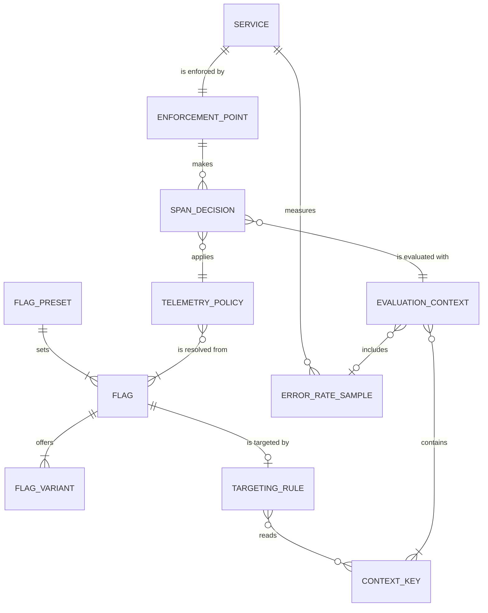

# Entity Model

Elaboration artifact, derived from [requirements.md](requirements.md).

This is not a database schema. The entities are the things the specs talk
about: flags, the policy resolved from them, the evaluation context, and where
the decision is enforced. Attribute tables use AIUP's closed data-type and
validation vocabulary. Things AIUP's entity format has no place for are added
after the entities as **reference data**: the concrete flags, the hard
floors, the evaluation-context contract, the enforcement points, what the
extensions write onto spans, and their configuration. Those tables are the
contract the code is checked against.

## Entity Relationship Diagram

### FLAG

An OpenFeature flag served by flagd from `src/flagd/flagd.json`.

| Attribute | Description | Data Type | Length/Precision | Validation Rules |
|---|---|---|---|---|
| key | Flag key as used by the SDKs | String | 100 | Not Null, Unique |
| valueType | Type of the variant values | String | 10 | Not Null, Values: boolean, string, number |
| defaultVariant | Variant served when no targeting rule matches | String | 50 | Not Null |
| state | flagd flag state | String | 10 | Not Null, Values: ENABLED, DISABLED |
| description | One-line purpose | String | 500 | Optional |
| consumer | Who evaluates it | String | 20 | Not Null, Values: extension, application |

### FLAG_VARIANT

One named value of a flag.

| Attribute | Description | Data Type | Length/Precision | Validation Rules |
|---|---|---|---|---|
| flagKey | Owning flag | String | 100 | Not Null, Foreign Key (FLAG.key) |
| name | Variant name in `flagd.json` | String | 50 | Not Null |
| value | Variant value, serialized | String | 100 | Not Null |

**Constraints:** (flagKey, name) unique.

### TARGETING_RULE

The flagd JsonLogic `targeting` block of a flag. Its presence switches the
extensions from the static fast path to per-span evaluation (NFR-003), or in
Python to a per-tracer decision when the rule is tracer-scoped.

| Attribute | Description | Data Type | Length/Precision | Validation Rules |
|---|---|---|---|---|
| flagKey | Flag the rule belongs to | String | 100 | Not Null, Foreign Key (FLAG.key) |
| expression | JsonLogic expression returning a variant name | String | 4000 | Not Null |
| tracerScoped | Every key the rule can read is present on the tracer (resource and scope keys), so Python decides once per tracer (OTelFeature/poc#12). Keys named in `missing`/`missing_some` count as read. `false` when the rule reads span keys, `targetingKey` (also implicit in `fractional`), `otelfeature.*`, a computed `var` path, or the provider's rules can't be read; also forced `false` while an OpenFeature global or transaction context, or API-level hooks, are set | Boolean | 1 | Not Null |

### FLAG_PRESET

A named, complete `flagd.json` for one stage state (OTelFeature/poc#26).

| Attribute | Description | Data Type | Length/Precision | Validation Rules |
|---|---|---|---|---|
| name | Preset name, also the file name in `src/flagd/presets/` | String | 50 | Not Null, Unique |
| scriptBeat | Talk beat the preset belongs to | String | 100 | Not Null |
| schemaValid | Validates against `https://flagd.dev/schema/v0/flags.json` | Boolean | 1 | Not Null |
| metadata.preset | The preset's own name in the flag-set `metadata`; flagd merges it into the metadata of every OFREP answer, so a flip can be confirmed without an extra flag (OTelFeature/poc#91) | String | 50 | Not Null, equals `name` |

**Presets are cumulative** (Simon, 2026-10-16, OTelFeature/poc#26, PR
OTelFeature/poc#41). Each Demo 2 and Demo 3 preset keeps the rules of the
preset before it, so a later beat never brings back what an earlier beat
dropped: `03-semconv-rules`, `03a-weather-boost` and `03b-incident` keep
`02-quiet-noise`'s `telemetryLevel=IO`, and `03a-weather-boost` and
`03b-incident` keep `03-semconv-rules`'s `recordSpan` rules (Demo 2 cuts by
span kind, Demo 3 by semconv rules: Simon, 2026-11-03, OTelFeature/poc#110,
UC-002 BR-009). Stage order: `00-baseline` →
`01-otel-off` → `02-quiet-noise` → `03-semconv-rules` → `03a-weather-boost`
→ `03b-incident`. `01-otel-off` is the exception: it is the baseline with
`otelEnabled` off. `00-baseline` is identical to `flagd.json`. See UC-008
BR-006.

| Preset | Adds to the previous preset | Script beat |
|---|---|---|
| `00-baseline` | nothing; no targeting, stock OTel behaviour | reset |
| `01-otel-off` | `otelEnabled` → `off` (on top of the baseline) | Demo 1 |
| `02-quiet-noise` | `telemetryLevel` → `io`: no `INTERNAL` spans, children re-attach to the real parent; `recordSpan` stays `on` without targeting (OTelFeature/poc#110) | Demo 2, UC-002 steps 1 to 4 |
| `03-semconv-rules` | `recordSpan` off for `geocode` `SERVER` spans on `url.path=/health` and for `weather` spans with `otel.scope.name=io.opentelemetry.jdbc` (in `02-quiet-noise` until OTelFeature/poc#110); `traceSampleRatio` 0.1 for production, 1.0 otherwise | Demo 3, UC-002 steps 5 and 6, UC-004 step 6 |
| `03a-weather-boost` | `traceSampleRatio` 0.5 for `weather` in production (the rest stays 0.1) | Demo 3, UC-004 step 7 |
| `03b-incident` | `weatherUpstreamFailure` → `incident` (OTelFeature/poc#28, PR OTelFeature/poc#42), and the control-loop rule first in `traceSampleRatio`: 1.0 when `otelfeature.http.server.error_rate` > 0.05, else `03a-weather-boost`'s rules (UC-005, OTelFeature/poc#29, PR OTelFeature/poc#56). Decided by Simon, 2026-10-16: the rule is in this preset only; going back to `03a-weather-boost` removes the fault and the rule, so `weather` is back at 0.5 at once (OQ-14) | Demo 3 incident; going back to `03a-weather-boost` ends it |

### TELEMETRY_POLICY

The single value an enforcement point reads per decision (OTelFeature/poc#9).
Every field defaults to the value derived from the startup env vars, so a
missing or broken flag means stock OTel behaviour (NFR-001). Env-var hard
floors (C-011) cap every field: a flag can only reduce telemetry.

| Attribute | Description | Data Type | Length/Precision | Validation Rules |
|---|---|---|---|---|
| enabled | Spans are created at all. `false` when `OTEL_SDK_DISABLED=true` (hard floor), `otelEnabled=false` or `telemetryLevel=OFF` (D2) | Boolean | 1 | Not Null |
| suppressInternal | `INTERNAL` spans are dropped. `true` when `telemetryLevel=IO` | Boolean | 1 | Not Null |
| recordSpan | This span is recorded. From the per-span flag `recordSpan`; not evaluated while `enabled=false` | Boolean | 1 | Not Null |
| sampleRatio | Trace-root sample ratio from `traceSampleRatio`; read for trace roots only | Decimal | 5,4 | Not Null, Min: 0.0, Max: 1.0 |
| static | All flags read resolved with reason `STATIC` (or are missing), so the policy is cached for the process | Boolean | 1 | Not Null |

### SERVICE

An instrumented process, identified by its OTel resource.

| Attribute | Description | Data Type | Length/Precision | Validation Rules |
|---|---|---|---|---|
| serviceName | `service.name` | String | 100 | Not Null |
| serviceNamespace | `service.namespace` | String | 100 | Optional |
| serviceVersion | `service.version` | String | 50 | Optional |
| deploymentEnvironment | `deployment.environment.name`, set by the service, not the collector (OTelFeature/poc#25) | String | 20 | Optional, Values: production, staging |
| language | `telemetry.sdk.language` | String | 10 | Not Null, Values: python, java |

**Constraints:** (serviceName, deploymentEnvironment) unique.

**Request paths in the demo stack.** The load generator calls `POST /geocode`
and `POST /weather` directly, so each service is the entry point (trace root)
of those traces and decides their sampling itself. The cross-service path
(FR-026, OTelFeature/poc#59) is `geocode`'s `POST /forecast` (same body as
`POST /geocode`): it resolves the coordinates, then calls `weather`'s
`POST /weather` over HTTP with the trace context propagated, and answers
with both results (404 for an unknown location, like `/geocode`). There `geocode` is the entry point and `weather` follows
the parent's decision (UC-004 BR-003). A failing or unreachable `weather` call makes
the `/forecast` request fail too (HTTP 502), so it counts as a `geocode` error.
The load generator calls `/forecast` once every 15 s per k6 instance
(`FORECAST_INTERVAL_SECONDS`), so any 10 s error-rate interval holds at most
one of them, among about 36 `geocode` requests: even when it fails,
`geocode`'s error rate stays near 3%, under the 5% threshold (UC-005 A7). A
10 s period could, with latency jitter, put two into one interval (2 of 37 is
5.4%). Each `geocode` instance
calls its own environment's `weather` (`WEATHER_URL`).

### ENFORCEMENT_POINT

Where a service applies the policy to a span. See the reference table below.

| Attribute | Description | Data Type | Length/Precision | Validation Rules |
|---|---|---|---|---|
| name | Enforcement point name | String | 50 | Not Null, Unique |
| language | Extension language | String | 10 | Not Null, Values: python, java |
| decidesAt | When the decision is taken | String | 20 | Not Null, Values: before-create, on-start |
| savesServiceCpu | Dropped spans are never created or populated | Boolean | 1 | Not Null |
| mode | Value of `OTELFEATURE_ENFORCEMENT` that selects it (Java only) | String | 10 | Optional, Values: sampler, processor |

### EVALUATION_CONTEXT

What a targeting rule sees for one decision. Built only when the policy is not
static (NFR-003). Resource keys and the error rate form a pre-built base
context; scope and span keys are merged per span.

| Attribute | Description | Data Type | Length/Precision | Validation Rules |
|---|---|---|---|---|
| targetingKey | Trace id, hex, so `fractional` buckets a trace the same in every service | String | 32 | Not Null, Format: 32 lower-case hex characters |
| shape | How dotted semconv names are represented (OQ-2, OTelFeature/poc#22) | String | 10 | Not Null, Values: nested (decided, OTelFeature/poc#22) |

### CONTEXT_KEY

One key of the evaluation-context contract.

| Attribute | Description | Data Type | Length/Precision | Validation Rules |
|---|---|---|---|---|
| name | Semconv attribute name | String | 100 | Not Null, Unique |
| source | Where the value comes from | String | 20 | Not Null, Values: resource, scope, span-start, metric, trace |
| dataType | Value type | String | 10 | Not Null, Values: string, number |
| knownAtStart | Available when the span starts (C-003) | Boolean | 1 | Not Null |

### ERROR_RATE_SAMPLE

One collection of the in-process delta metric reader (FR-011, decision D5).

| Attribute | Description | Data Type | Length/Precision | Validation Rules |
|---|---|---|---|---|
| serviceName | Service that recorded the metric | String | 100 | Not Null |
| collectedAt | Collection time | DateTime | | Not Null |
| totalCount | Sum of `http.server.request.duration` point counts in the interval | Long | 19 | Not Null, Min: 0, Max: 9223372036854775807 |
| errorCount | Sum of counts of points with `error.type` set (Python fallback without the stable opt-in: `http.status_code >= 500`; with `http/dup` only the stable metric counts) | Long | 19 | Not Null, Min: 0, Max: 9223372036854775807 |
| errorRate | errorCount / totalCount; absent when totalCount is below `OTELFEATURE_ERROR_RATE_MIN_REQUESTS` (default 10), even when every request failed | Decimal | 5,4 | Optional, Min: 0.0, Max: 1.0 |

### SPAN_DECISION

The outcome for one span start.

| Attribute | Description | Data Type | Length/Precision | Validation Rules |
|---|---|---|---|---|
| outcome | What happens to the span. DROP: not sampled, takes the subtree, downstream gets `sampled=0`. SUPPRESS: only this span is left out; children attach to the real parent and the trace stays sampled | String | 10 | Not Null, Values: RECORD, DROP, SUPPRESS, DELEGATE |
| spanKind | Kind of the span asked about | String | 10 | Not Null, Values: server, client, producer, consumer, internal |
| isRoot | Span has no valid parent, **or** it is an incoming request span (`SERVER`/`CONSUMER`) whose parent is remote | Boolean | 1 | Not Null |

Nothing about the decision is written onto the span (FR-014).

## Reference data

### Flags

| Key | Type | Variants | Default | Consumer | Status | Issue |
|---|---|---|---|---|---|---|
| `otelEnabled` | boolean | `on`=true, `off`=false | `on` | extension | released (otelfeature-instrument v0.3.0, otelfeature-java-extension v0.4.0): Python OTelFeature/otelfeature-instrument#10, Java OTelFeature/otelfeature-java-extension#24; in `flagd.json` since PR OTelFeature/poc#41 (merged) | OTelFeature/poc#8 |
| `telemetryLevel` | string | `full`=FULL, `io`=IO, `off`=OFF | `full` | extension | FULL/IO/OFF released (OFF since otelfeature-instrument v0.3.0, otelfeature-java-extension v0.4.0: Python #10, Java #24); `io` is Demo 2 (`02-quiet-noise`, OTelFeature/poc#110) | OTelFeature/poc#8 |
| `recordSpan` | boolean | `on`=true, `off`=false | `on` | extension | released (v0.3.0 / v0.4.0): Python OTelFeature/otelfeature-instrument#18, Java OTelFeature/otelfeature-java-extension#29 (landed via #33); carries the drop rules, Demo 3 since OTelFeature/poc#110 (OQ-8) | OTelFeature/otelfeature-instrument#14, OTelFeature/otelfeature-java-extension#27 |
| `traceSampleRatio` | number | `all`=1.0, `half`=0.5 (PR OTelFeature/poc#56, merged), `tenth`=0.1, `none`=0.0 | `all` | extension | released (v0.3.0 / v0.4.0): Python OTelFeature/otelfeature-instrument#13, Java OTelFeature/otelfeature-java-extension#30 (landed via #33); in `flagd.json` since PR OTelFeature/poc#41 (merged) | OTelFeature/poc#10 |
| `weatherUpstreamFailure` | number | `none`=0.0, `incident`=0.5 (UC-006 BR-003), `outage`=1.0 (e2e) | `none` | application (`weather`) | merged (OTelFeature/poc#42) | OTelFeature/poc#28 |
| `geocodeUpstreamFailure` | number | e2e only: `none`=0.0, `outage`=1.0 | `none` (not in the stage presets; missing resolves to 0.0) | application (`geocode`) | OTelFeature/poc#80 | OTelFeature/poc#80 |
| `signalsEnabled` | object | per signal | all on | extension | deferred, out of scope (OTelFeature/poc#11 closed as not planned) | OTelFeature/poc#11 |

The variant names in this table are the ones `src/flagd/flagd.json` and the
presets use (PR OTelFeature/poc#41, `weatherUpstreamFailure` in PR
OTelFeature/poc#42, both merged).

Flag keys can be overridden by env var; see [Configuration](#configuration).

### Flag file reload

flagd (v0.17, `--uri file:`, polling `fileinfo` watcher) and the Python
provider's file watcher reload a flag file **only when its mtime strictly
increases**. Linux file timestamps are coarse, so a rewrite within the same
tick keeps the old mtime and is silently ignored for good. Measured on PR
OTelFeature/poc#41: two plain `cp`s in a row lost the second flip.

Every writer of a watched flag file therefore:

1. **Bumps the mtime.** It leaves the file with an mtime strictly newer than
   before. Stage tooling (`make flag`, `make demo-reset` and the `flag`
   compose service, `docker compose run --rm flag <preset>`) goes through
   `src/flagd/apply-preset.sh`: write a temp file, set its mtime to
   `max(old, now) + 1 s`, rename it over the target (atomic, so no reader
   sees a half-written file). Test helpers do the same in their language; the
   Python fix: if the mtime did not increase after the write, `os.utime` it
   to the old mtime + 10 ms.
2. **Confirms the new value** before it counts spans: it polls flagd over
   OFREP (port 8016) until flagd serves the new value (the e2e suite adds a
   per-write revision flag for this), with a timeout that fails the run. OFREP
   only verifies the served value; the services evaluate in process (C-002).
   The `flag` compose service confirms a preset by its own name: it polls
   OFREP until the answer's metadata carries `preset` = the preset it wrote
   (FLAG_PRESET `metadata.preset`), and exits non-zero after
   `FLAG_CONFIRM_TIMEOUT` seconds. `make flag` only writes; it counts no
   spans and does not confirm.

This applies to the preset scripts, `make demo-reset`, the extension tests
that rewrite flag files, and the e2e flag-flip helper (NFR-004, TC-006).

### Policy field resolution

| Field | From flags | Startup default (flag missing or broken) |
|---|---|---|
| `enabled` | `otelEnabled != false` and `telemetryLevel != OFF`, unless the hard floor applies | `true`; `false` when `OTEL_SDK_DISABLED=true`, and then no flag can make it `true` |
| `suppressInternal` | `telemetryLevel == IO` | `false` |
| `recordSpan` | `recordSpan` flag, per span; only read while `enabled` | `true` |
| `sampleRatio` | `traceSampleRatio`; above 1.0 clamped to 1.0; negative, NaN, infinity or non-numeric falls back, logged once per state change (NFR-001); trace roots only | From `OTEL_TRACES_SAMPLER` / `OTEL_TRACES_SAMPLER_ARG`, parsed like the SDK: the ratio for `traceidratio`/`parentbased_traceidratio`, 0.0 for `always_off`/`parentbased_always_off`, else 1.0. Python: an unknown name falls back to 1.0 with a warning (C-012) |

Precedence: hard floors > `otelEnabled`/`telemetryLevel=OFF` > `recordSpan` >
`traceSampleRatio`. A lower level never re-enables what a higher one turned
off. Unknown `telemetryLevel` values resolve to `FULL` (existing behaviour,
kept).

### Hard floors

Flags only reduce telemetry. They never enable what an env var switched off
(C-011).

| Env var | Effect | Can a flag override it? | Can a sampled parent override it? |
|---|---|---|---|
| `OTEL_SDK_DISABLED=true` | No spans. Java: autoconfigure still calls the customizer, which installs nothing (no sampler, no processor, no flagd connection). Python: the policy is fixed at `enabled=false` | no | no |
| `OTEL_TRACES_SAMPLER=always_off` | Nothing is sampled; `traceSampleRatio=1.0` has no effect | no | no |
| `OTEL_TRACES_SAMPLER=parentbased_always_off` | Standard meaning: no trace starts sampled in this service; sampled parents are followed | no (for roots) | yes, as the standard sampler does |

### Evaluation-context contract

Shape: **nested by dot segment**, `service.name` → `{"service": {"name": ...}}`.
Flat dotted keys never match in any of flagd's evaluators (OTelFeature/poc#22,
OQ-2 resolved). Collision rules:

- **Leaf/prefix collision** (`db.system` and `db.system.name`): the namespace
  wins, the leaf value is left out.
- **Extension-provided keys win** over a clashing span start attribute:
  resource keys, `span.kind`, `otel.scope.*`.
- **`otelfeature.*` is reserved.** Span attributes in that namespace are
  ignored, so a span cannot fake the error rate.
- **`targetingKey`** is the trace id.

| Key | Source | Type | Known at start | Notes |
|---|---|---|---|---|
| `targetingKey` | trace | string | yes | Trace id (hex). Python roots: the id must exist before evaluation and be kept by the span. `fractional` on it is the only bucketing that agrees across languages; the plain ratio uses each SDK's own formula (UC-004 BR-008) |
| `service.name` | resource | string | yes | |
| `service.namespace` | resource | string | yes | |
| `service.version` | resource | string | yes | |
| `deployment.environment.name` | resource | string | yes | Must be set by the service (OTelFeature/poc#25) |
| `telemetry.sdk.language` | resource | string | yes | |
| `otel.scope.name` | scope | string | yes | Python: `instrumenting_module_name`; Java: `InstrumentationScopeInfo` name |
| `otel.scope.version` | scope | string | yes | |
| `span.kind` | span-start | string | yes | Lower-case semconv value |
| `span.name` | span-start | string | yes | |
| `url.path` | span-start | string | if set | Use instead of `http.route` (D6) |
| `http.request.method` | span-start | string | if set | |
| `server.address` | span-start | string | if set | |
| `db.system.name` | span-start | string | if set | Marks DB client leaf spans |
| `db.operation.name` | span-start | string | if set | |
| `rpc.service` | span-start | string | if set | |
| `otelfeature.http.server.error_rate` | metric | number | yes | Extension-owned. Absent when the last interval had fewer than `OTELFEATURE_ERROR_RATE_MIN_REQUESTS` requests (FR-011), and always absent with `OTEL_METRICS_EXPORTER=none` (FR-024); lags one to two intervals (NFR-014) |
| `http.route` | span-end | - | **no** | Not available; do not write rules on it |
| `http.response.status_code` | span-end | - | **no** | Not available; do not write rules on it |

### Enforcement points

| Name | Language | Decides at | Saves service CPU | Can drop | State |
|---|---|---|---|---|---|
| Tracer wrapper (`_VerbosityAwareTracer`) | python | before-create | yes | Non-root: suppresses just this span, children attach to the real parent. Root (incl. remote-parent `SERVER`/`CONSUMER`): returns a non-recording span with a valid, non-sampled context, so the request is dropped in this service and downstream gets `sampled=0` | INTERNAL under `IO`, `OFF` and `recordSpan` released (v0.3.0 / v0.4.0) |
| Per-tracer decision (`_VerbosityAwareTracerProvider.get_tracer`) | python | before-create, once per tracer | yes | everything from one scope, when the rule is tracer-scoped (see TARGETING_RULE) | released in v0.3.0 (OTelFeature/otelfeature-instrument#17, OTelFeature/poc#12) |
| Python sampler (`ParentBased(root=flag ratio)`) | python | before-create | yes | trace roots by ratio; children parent-based | released in v0.3.0 (OTelFeature/otelfeature-instrument#13, OTelFeature/poc#10) |
| `FilteringSpanProcessor` + `ReparentingSpanExporter` | java | on-start (span already created) | no (saves batching, serialization, export) | any kind, suppressed at `onStart`; children re-parented | INTERNAL under `IO`, `OFF` and `recordSpan` released (v0.3.0 / v0.4.0) |
| `FlagAwareSampler` | java | before-create | yes | `DROP` for roots (incl. remote-parent entry spans) and non-propagating leaves (DB client spans, `db.system.name`); ratio on trace roots | released in v0.4.0, via landing PR OTelFeature/otelfeature-java-extension#33 (#26 for java#21, #29 for java#27, #30 for the ratio, OTelFeature/poc#10) |

Java mode is chosen with `OTELFEATURE_ENFORCEMENT=processor|sampler`, default
`processor`, which is also the mode for the talk (D3, decided 2026-10-16 from the OTelFeature/poc#27 measurements, OQ-1). In sampler mode, the
processor still enforces mid-trace `INTERNAL` suppression (`IO`), `recordSpan`
for spans that propagate mid-trace, and rules the sampler can't see (a
`Sampler` is not told the instrumentation scope, so a rule on
`otel.scope.name` is enforced by the processor). The sampler is installed in
both modes because only a sampler can apply `traceSampleRatio`; in processor
mode it applies only the ratio.

Known Java edge, documented, not fixed: with a non-parent-based sampler (for
example `OTEL_TRACES_SAMPLER=always_on`), children of a root dropped by
`recordSpan` are sampled as orphans (OTelFeature/otelfeature-java-extension#27).

### What the extensions write onto spans

Nothing (FR-014). Recording flag evaluations is the OpenFeature OpenTelemetry
hook's job, registered by whoever wants it, typically the application for its
own flags (OTelFeature/poc#30).

| Item | Written by the extension? |
|---|---|
| `feature_flag.*` attributes or events | no; only via the opt-in hook below |
| `otelfeature.sample_ratio` | no |
| tracestate `ot=th` (sampling threshold) | no |
| Hook events for the extension's own evaluations | only with `OTELFEATURE_OPENFEATURE_TRACING_HOOK=true` (never default); evaluation exceptions are excluded. Python: `feature_flag.evaluation` (current names); Java (OTelFeature/otelfeature-java-extension#39, released in v0.5.0): event `feature_flag` with the semconv 1.28 names (UC-007 BR-004) |

Caveat of the opt-in hook: it writes to the span that is current on the
thread at evaluation time, usually the **parent** of the span being decided.
So decisions for new roots started with no span current (including every
`traceSampleRatio` decision for an incoming request) and for dropped spans
record nothing (UC-007 BR-003).

### Configuration

| Env var | Default | Language | Meaning |
|---|---|---|---|
| `OTELFEATURE_ENFORCEMENT` | `processor` | java | `processor` or `sampler`; the talk uses `processor` (FR-008, D3, OQ-1) |
| `OTELFEATURE_FLAG_NAME` | `telemetryLevel` | java | Key of the level flag |
| `OTELFEATURE_ENABLED_FLAG_NAME` | `otelEnabled` | java | Key of the kill-switch flag |
| `OTELFEATURE_RECORD_SPAN_FLAG_NAME` | `recordSpan` | both | Key of the per-span drop flag |
| `OTELFEATURE_SAMPLE_RATIO_FLAG_NAME` | `traceSampleRatio` | java | Key of the ratio flag |
| `OTELFEATURE_ERROR_RATE_INTERVAL` | `10` | both | Seconds between error-rate collections |
| `OTELFEATURE_ERROR_RATE_MIN_REQUESTS` | `10` | both | Minimum requests per interval before a rate is published |
| `OTELFEATURE_OPENFEATURE_TRACING_HOOK` | `false` | both | `true` (case and surrounding whitespace ignored; anything else is off) records the extension's own evaluations through the OpenFeature OTel hook, attached only to the extension's own client. Java: OTelFeature/otelfeature-java-extension#39, released in v0.5.0 |
| `OTELFEATURE_FLAG_PROVIDER` | `flagd` | python | `none` lets the application manage OpenFeature (NFR-009) |
| `OTEL_SEMCONV_STABILITY_OPT_IN` | unset | python | Documented, not set by the extension (C-005) |
| `OTEL_METRICS_EXPORTER` | `otlp` | both | Honoured like the SDK (FR-024). `none`: no metrics SDK, so the error-rate reader is not registered, `otelfeature.http.server.error_rate` is absent and error-rate rules never match. Java: OTelFeature/otelfeature-java-extension#31; Python: OTelFeature/otelfeature-instrument#15 |
| `OTEL_TRACES_EXPORTER` | `otlp` | both | Honoured like the SDK (FR-025). `none`: nothing is exported; the tracer, the flag policy and context propagation keep working and the recording CPU cost remains. Java: SDK autoconfigure; Python: OTelFeature/otelfeature-instrument#19 |

Measurement harness (`make bench`, UC-003, TC-003):

| Variable | Default | Meaning |
|---|---|---|
| `BENCH_WARMUP` | `120` | Seconds of traffic before each measured window, after the run recreated `geocode`, `weather` and the load generator |
| `BENCH_SECONDS` | `240` | Length of each measured window |
| `BENCH_RATE` | `1` | Multiplies the load generator's business requests (`POST /geocode`, `POST /weather`) and health checks (`1` = the stage load); the `/forecast` path stays at one per 15 s. Demo 2 savings are quoted at `1`, because the share of health checks decides them |

Exporter values: only an exact `none` switches export off (case and
surrounding whitespace ignored). `none` mixed with other values logs a warning
and keeps exporting. Python exports any other value over OTLP/HTTP.

Python's other flag keys (`telemetryLevel`, `otelEnabled`,
`traceSampleRatio`) are fixed.

Java's error-rate settings follow the Python names
(OTelFeature/otelfeature-java-extension#22, released in v0.4.0 via
OTelFeature/otelfeature-java-extension#31 and landing PR #33). Java's tracing-hook
setting follows the Python name and semantics (OTelFeature/otelfeature-java-extension#39; released in v0.5.0).
It adds `dev.openfeature.contrib.hooks:otel` to the client of the extension's
isolated OpenFeature API, never to the application's. The extension still
writes nothing onto spans itself (FR-014;
OTelFeature/otelfeature-java-extension#23 was closed as not planned).

Demo stack (`compose.yaml`, NFR-017, OTelFeature/poc#91):

| Variable | Default | Meaning |
|---|---|---|
| `POC_IMAGE_TAG` | `main` | Tag of the prebuilt `geocode`, `weather` and `stub-apis` images that `docker compose pull` and `up` use: `main`, or a `sha-<short commit>` to pin exactly the images of one commit (for example the rehearsed ones). Ignored by the e2e suite, which builds its own images |
| `FLAG_CONFIRM_TIMEOUT` | `10` | Seconds the `flag` compose service waits for flagd to serve the preset it wrote before it fails |
| `OTEL_INSTRUMENTATION_COMMON_EXPERIMENTAL_CONTROLLER_TELEMETRY_ENABLED` | `true` (set for `weather` in `compose.yaml`; the Java agent's own default is `false`) | Makes the Java agent create Spring MVC controller spans (`INTERNAL`), so `weather` has `INTERNAL` spans for `telemetryLevel=IO` to suppress in Demo 2 (UC-002 A9) |
| `FLAGD_OFREP_URL` | `http://flagd:8016` | flagd's OFREP endpoint that the `flag` service and the e2e flag helper confirm a write against |

### Prebuilt images

Published by `.github/workflows/images.yml` on every push to `main` and on
manual runs; pull requests build them for both platforms without pushing
(NFR-017, OTelFeature/poc#91).

| Image | Built from | Platforms | Tags | Pinned versions in the labels |
|---|---|---|---|---|
| `ghcr.io/otelfeature/poc-geocode` | `src/geocode` | `linux/amd64`, `linux/arm64` | `main`, `sha-<short>` | `io.github.otelfeature.instrument.version`: the `otelfeature-instrument` tag in `uv.lock` (C-006) |
| `ghcr.io/otelfeature/poc-weather` | `src/weather` | `linux/amd64`, `linux/arm64` | `main`, `sha-<short>` | `io.github.otelfeature.java-extension.version`: `OTELFEATURE_EXTENSION_VERSION` (C-006); `io.opentelemetry.javaagent.version`: `OTEL_AGENT_VERSION` |
| `ghcr.io/otelfeature/poc-stub-apis` | `src/stub-apis` | `linux/amd64`, `linux/arm64` | `main`, `sha-<short>` | none |

Every image also carries `org.opencontainers.image.source` (the repository),
`org.opencontainers.image.revision` (the full commit) and
`org.opencontainers.image.created`. A manual run on a branch other than
`main` pushes only `sha-<short>`. Images are always built from the pinned
releases; a git-ref build (C-013) is for the e2e suite only and is never
published.

### `OTEL_*` env vars and live flags

Which standard `OTEL_*` env vars have a live flag, which can't have one, and
why (FR-021, UC-009 BR-003). From OTelFeature/poc#14, with the audit
correction of 2026-10-16: the `*_EXPORTER=none` values are honoured only as
startup env vars.

**Governing rule: the env var is the default, the flag is the live
override.** Every policy field starts from the value its startup env vars
give, read the way the stock SDK or agent reads them
([policy field resolution](#policy-field-resolution)). A flag changes the
field while the process runs, and when the flag can't be evaluated the field
falls back to the env var value (NFR-001). The two exceptions are the
[hard floors](#hard-floors) (C-011): `OTEL_SDK_DISABLED=true` and
`OTEL_TRACES_SAMPLER=always_off`. There the env var wins and no flag
overrides it: flags never re-enable what a hard floor switched off.

| Tier | Env var | Live flag | Why |
|---|---|---|---|
| Live flag | `OTEL_SDK_DISABLED` | `otelEnabled=false`, `telemetryLevel=OFF` | The SDK reads the env var once, at startup. The flags suppress spans instead of disabling the SDK (FR-001, FR-002). `true` is a hard floor |
| Live flag | `OTEL_TRACES_SAMPLER`, `OTEL_TRACES_SAMPLER_ARG` | `traceSampleRatio`, for trace roots | The env vars give the fallback ratio (FR-009). `always_off` is a hard floor; `parentbased_always_off` keeps its standard meaning |
| Live flag, approximated | `OTEL_INSTRUMENTATION_<name>_ENABLED` (Java agent; for Python see `OTEL_PYTHON_DISABLED_INSTRUMENTATIONS`) | A `telemetryLevel` targeting rule on `otel.scope.name` | Scope filtering, not the same thing: the instrumentation stays installed and still runs its hooks; only its spans are left out, and their children attach to the parent. A `recordSpan` rule on the scope (FR-023) goes further: a root or entry span from that scope drops its whole local trace and sends `sampled=0` downstream, which disabling the instrumentation would not do. In Java sampler mode the processor enforces a scope rule (C-004) |
| Startup only, honoured | `OTEL_TRACES_EXPORTER=none` | none | Honoured at startup like the SDK (FR-025). A live per-signal switch, `signalsEnabled`, is deferred: OTelFeature/poc#11 closed as not planned (FR-022) |
| Startup only, honoured | `OTEL_METRICS_EXPORTER=none` | none | Honoured at startup like the SDK (FR-024); no error rate then. Same deferral as above |
| Startup only | `OTEL_LOGS_EXPORTER` | none | Java: the agent reads it at startup. Python: otelfeature-instrument sets up no logs pipeline, so it has no effect. Logs are out of scope (C-001) |
| Feasible, deferred | `OTEL_SPAN_ATTRIBUTE_VALUE_LENGTH_LIMIT`, `OTEL_ATTRIBUTE_COUNT_LIMIT` | none | Fixed in the span limits when the tracer provider is built. An exporter-side truncating wrapper could approximate them, as a "we're leaking large payloads or blowing up cardinality, clamp it now" lever, but its semantics differ from the real limits |
| Feasible, deferred | `OTEL_BSP_SCHEDULE_DELAY`, `OTEL_METRIC_EXPORT_INTERVAL` | none | Read when the span processor or metric reader is built. Changing them live means rebuilding it mid-flight, with a flush: fiddly, for a small payoff |
| Feasible, deferred | `OTEL_PROPAGATORS` | none | The easiest of this tier (a delegating propagator), but no incident is known where flipping propagators live is the answer |
| Excluded: security | `OTEL_EXPORTER_OTLP_ENDPOINT`, `OTEL_EXPORTER_OTLP_HEADERS` (and their per-signal variants) | none, by decision | Feasible (rebuild the exporter, flush), but must not ship. A flag that redirects a fleet's telemetry to an arbitrary endpoint is a data-exfiltration primitive, and flagd rulesets usually have weaker access control than deployment config; the headers carry credentials. If it is ever built, it may only choose from an allowlist of endpoints fixed at startup |
| Cannot be a flag | `OTEL_SERVICE_NAME`, `OTEL_RESOURCE_ATTRIBUTES` | none | The resource is fixed when the providers are built, and every span and the evaluation context's resource keys come from it |
| Cannot be a flag | `OTEL_EXPORTER_OTLP_PROTOCOL` | none | Chooses the exporter implementation at startup |
| Cannot be a flag | `OTEL_JAVAAGENT_ENABLED` | none | Decides whether the Java agent loads at all; without the agent there is no extension to read a flag |
| Cannot be a flag | `OTEL_PYTHON_DISABLED_INSTRUMENTATIONS` | none | Decides at launch which instrumentors patch the libraries; nothing re-reads it. The live approximation is the scope rule above |
| Cannot be a flag | `OTEL_SEMCONV_STABILITY_OPT_IN` | none | Each instrumentation picks its attribute and metric names when it is installed (C-005) |

The env vars in the last tier are consumed once, before there is anything to re-evaluate,
and have no read point at runtime to intercept. A flag for one of them would
only take effect at the next restart, and at a restart the env var already
does the job.

An `OTEL_*` env var not in this table has no live flag. A proposal for one
names its tier first.

**Out of scope: startup-time flags.** Reading configuration from flagd at
bootstrap would give central configuration without a redeploy per service,
though not without a restart. It is a different product line, and this
project does not pursue it.
