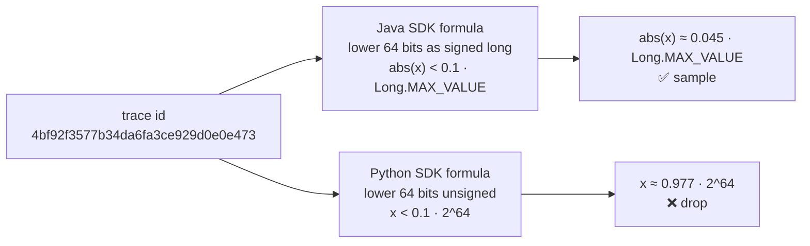
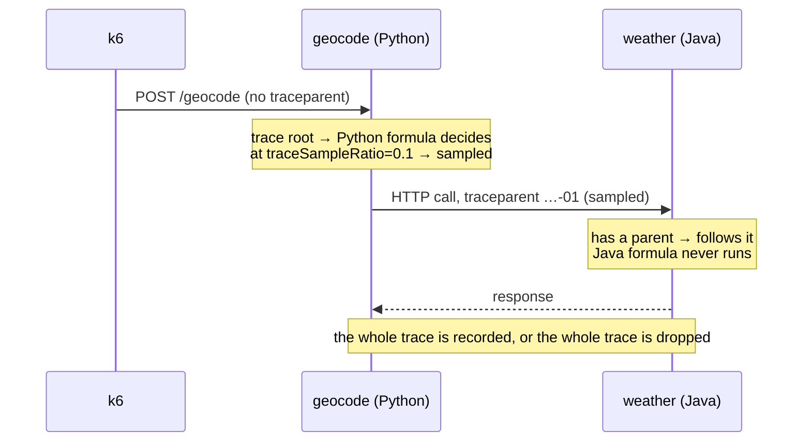
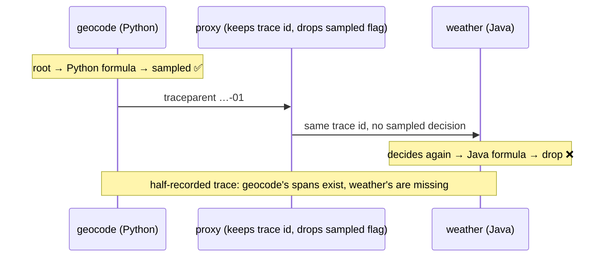

# traceSampleRatio: Java and Python parity

At the same `traceSampleRatio`, the Java and Python extensions can decide
differently for the same trace id, because each uses its own OTel SDK's
trace-id formula. Decision (2026-10-16): **accept and document**. It is
harmless with parent-based propagation. For cross-language consistency, bucket
with a flagd `fractional` rule on `targetingKey` (the trace id). See
[UC-004 BR-008](use_cases/UC-004-target-trace-sampling.md#br-008-cross-language-ratio-parity-is-not-guaranteed-accepted-simon-2026-10-16)
and FR-009.

## 1. The formulas differ

The same trace id goes into each SDK's formula, and at 10% the answers can
differ.



The lower 64 bits here are `fa3ce929d0e0e473`. The top bit is set, so Java
reads a small negative number (its absolute value is under the bound), while
Python reads a large unsigned one.

## 2. Why it usually doesn't matter

Only the service where the trace starts decides. Every service after it
follows the `sampled` flag in `traceparent`.



## 3. When it does matter

It only goes wrong if two services each decide for the same trace id. For
example, a proxy in between keeps the trace id but drops the `sampled` flag.



## The fix for case 3

Bucket with a flagd `fractional` rule on the trace id. flagd computes the same
bucket in every language, so both services agree.

```json
"traceSampleRatio": {
  "state": "ENABLED",
  "defaultVariant": "tenth",
  "variants": { "all": 1.0, "tenth": 0.1, "none": 0.0 },
  "targeting": {
    "fractional": [
      { "var": "targetingKey" },
      ["all", 10],
      ["none", 90]
    ]
  }
}
```

Here `fractional` keeps 10% of traces (`all`) and drops 90% (`none`). The
bucket comes from the trace id, so both languages land in the same one.
