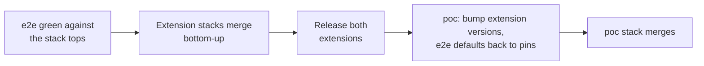

# Traceability Matrix

Links every script beat to its requirements, use cases, test cases and the
GitHub issues that implement them. When any of these changes, update this
file in the same change.

Issue refs: `OTelFeature/poc#N` (poc), `OTelFeature/otelfeature-instrument#N`
(Python), `OTelFeature/otelfeature-java-extension#N` (Java).

## Script beat → spec → issue

| Script beat | Requirements | Use case | Test case | Issues |
|---|---|---|---|---|
| Cold open: wall of spans (OTel Demo) | C-007 | UC-008 | TC-006 | OTelFeature/poc#33 |
| "Let me show you on something smaller" (transition to POC) | FR-018, FR-019 | UC-008 | TC-006 | OTelFeature/poc#24, OTelFeature/poc#26 |
| Demo 1: one flag turns OTel off, zero span ingest | FR-001, FR-002, FR-004, NFR-001, NFR-003, NFR-004, C-011 | UC-001 | TC-001 | OTelFeature/poc#8, OTelFeature/poc#9, OTelFeature/otelfeature-java-extension#21 |
| Demo 2: the SDK asks OpenFeature before the span exists | FR-006, FR-008, FR-023, C-004 | UC-002 | TC-002 | OTelFeature/otelfeature-java-extension#21, OTelFeature/otelfeature-instrument#14, OTelFeature/otelfeature-java-extension#27 |
| Demo 2: context = service name, instrumentation scope, the path | FR-005, C-003 | UC-002 | TC-002 | OTelFeature/poc#22, OTelFeature/otelfeature-instrument#7, OTelFeature/otelfeature-java-extension#20 |
| Demo 2: health checks off in one service, DB spans off in another | FR-006, FR-007, FR-023, NFR-007 | UC-002 | TC-002 | OTelFeature/otelfeature-instrument#7, OTelFeature/otelfeature-java-extension#20, OTelFeature/otelfeature-java-extension#21, OTelFeature/otelfeature-instrument#14, OTelFeature/otelfeature-java-extension#27, OTelFeature/poc#12 |
| Demo 2: CPU [X%], memory [Y MB], export bytes [Z%] | FR-016, NFR-005, NFR-006, NFR-011 | UC-003 | TC-003 | OTelFeature/poc#27 |
| Demo 3: rules on `service.name`, `deployment.environment.name` | FR-005, FR-010 | UC-004 | TC-004 | OTelFeature/poc#25, OTelFeature/otelfeature-instrument#7, OTelFeature/otelfeature-java-extension#20 |
| Demo 3: sample rate as a number flag | FR-009, NFR-007, C-011, C-012 | UC-004 | TC-004 | OTelFeature/poc#10 |
| Demo 3: errors rise, a rule turns sampling up for that service | FR-011, FR-012, FR-013, NFR-013, NFR-014, C-005 | UC-005, UC-006 | TC-005 | OTelFeature/poc#28, OTelFeature/otelfeature-instrument#8, OTelFeature/otelfeature-java-extension#22, OTelFeature/poc#29 |
| Demo 3: the flag explains itself (wording open, OQ-9) | FR-014, FR-015 | UC-007 | TC-005 | OTelFeature/poc#30, OTelFeature/otelfeature-instrument#9, OTelFeature/otelfeature-java-extension#23 |
| "Why not the collector?" (could read the same flags) | C-010 | - | - | none (D4, script only) |
| CTA: repo and demo on the slide | FR-020, FR-021 | UC-009 | TC-007 | OTelFeature/poc#31, OTelFeature/poc#14 |
| Stage risk: live demo fails | C-008 | UC-008 | TC-006 | OTelFeature/poc#32 |
| Stage risk: a beat broke since the last rehearsal | NFR-004, NFR-012, NFR-015, NFR-016, C-013, C-014 | UC-008 (BR-005) | TC-001, TC-002, TC-004, TC-005, TC-006 (Automation sections) | OTelFeature/poc#35, OTelFeature/otelfeature-instrument#20, OTelFeature/otelfeature-java-extension#32 |
| Q&A: what else can become a flag | FR-021 | UC-009 | TC-007 | OTelFeature/poc#14, OTelFeature/poc#15 |

## Issue → spec

Priority as in `DEMO-BACKLOG.md`, updated with the 2026-10-16 changes that
moved OTelFeature/poc#23 and OTelFeature/poc#11 to P2 and added `recordSpan`,
the end-to-end suite and the toolchain images.

| Issue | Title (short) | Pri | Requirements | Use case | Test case |
|---|---|---|---|---|---|
| OTelFeature/poc#8 | `OFF` variant + `otelEnabled` | P0 | FR-001, FR-002, NFR-001 | UC-001 | TC-001 |
| OTelFeature/poc#9 | `TelemetryPolicy`, `OTEL_SDK_DISABLED` hard floor | P0 | FR-004, NFR-001, C-011 | UC-001, UC-002, UC-004 | TC-001 |
| OTelFeature/poc#10 | `traceSampleRatio` | P0 | FR-009, NFR-007, C-011, C-012 | UC-004, UC-005 | TC-001, TC-004 |
| OTelFeature/poc#11 | `signalsEnabled` (metrics/logs gating) | P2, out of scope | FR-022 | - | - |
| OTelFeature/poc#12 | Per-tracer scope decision (Python) | P1 | FR-007 | UC-002 (A2, BR-007) | TC-002 |
| OTelFeature/poc#14 | Env-var tier docs | P2 | FR-021 | UC-009 | TC-007 |
| OTelFeature/poc#15 | Roadmap | P2 | - | - | - |
| OTelFeature/poc#22 | Spike: dotted semconv keys | P0 | FR-005 | UC-002, UC-004 | TC-002 |
| OTelFeature/poc#23 | Noisy demo | P2, deferred | FR-017 | none | none |
| OTelFeature/poc#24 | Offline stage mode | P0 | FR-018, C-009 | UC-008, UC-009 | TC-006 |
| OTelFeature/poc#25 | Resource attrs, prod/staging | P0 | FR-010 | UC-004 | TC-004 |
| OTelFeature/poc#26 | Stage controls | P0 | FR-019 | UC-008 | TC-006 |
| OTelFeature/poc#27 | Measurement harness | P1 | FR-016, NFR-005, NFR-011 | UC-003 | TC-003 |
| OTelFeature/poc#28 | Fault-injection flag | P1 | FR-012 | UC-006 | TC-005 |
| OTelFeature/poc#29 | Control-loop preset | P1 | FR-013, NFR-012 | UC-005 | TC-005 |
| OTelFeature/poc#30 | OpenFeature OTel hooks in the apps | P1 | FR-015 | UC-007 | TC-005 |
| OTelFeature/poc#31 | Public repo | P1 | FR-020 | UC-009 | TC-007 |
| OTelFeature/poc#32 | Fallback video | P2 | C-008 | UC-008 | TC-006 |
| OTelFeature/poc#33 | OTel Demo footage | P1 | C-007 | UC-008 | TC-006 |
| OTelFeature/poc#35 | End-to-end suite in CI, safety net before merging | P1 | NFR-015, C-013 (verifies NFR-004, NFR-012) | UC-008 (BR-005) | TC-001, TC-002, TC-004, TC-005, TC-006 |
| OTelFeature/otelfeature-instrument#7 | Eval context from semconv (Python) | P0 | FR-005, NFR-003 | UC-002, UC-004 | TC-002, TC-004 |
| OTelFeature/otelfeature-instrument#8 | Error rate into context (Python); also `OTEL_METRICS_EXPORTER=none` | P1 | FR-011, FR-024, NFR-013, NFR-014, C-005 | UC-005 | TC-005 |
| OTelFeature/otelfeature-instrument#9 | No decision attributes; opt-in tracing hook (Python) | P1 | FR-014, NFR-006 | UC-007 | TC-005 |
| OTelFeature/otelfeature-instrument#14 | `recordSpan` (Python) | P0 | FR-006, FR-007, FR-023 | UC-002 | TC-002 |
| OTelFeature/otelfeature-instrument#19 | `OTEL_TRACES_EXPORTER=none` (Python); a PR with no separate issue | - | FR-025 | none (SDK parity) | TC-001 |
| OTelFeature/otelfeature-instrument#20 | Toolchain image `ci/Dockerfile` and first test CI (Python) | P1 | NFR-016, C-014 | none (tooling) | none |
| OTelFeature/otelfeature-java-extension#20 | Eval context from semconv (Java) | P0 | FR-005, NFR-003 | UC-002, UC-004 | TC-002, TC-004 |
| OTelFeature/otelfeature-java-extension#21 | `FlagAwareSampler`, switchable | P0 | FR-006, FR-008, C-004 | UC-001, UC-002, UC-003 | TC-001, TC-002, TC-003 |
| OTelFeature/otelfeature-java-extension#22 | Error rate into context (Java); also `OTEL_METRICS_EXPORTER=none` | P1 | FR-011, FR-024, NFR-013, NFR-014 | UC-005 | TC-005 |
| OTelFeature/otelfeature-java-extension#23 | Decision attributes (Java); may be closed as covered, since the extension writes none (FR-014) | P1 | FR-014 | UC-007 | TC-005 |
| OTelFeature/otelfeature-java-extension#27 | `recordSpan` (Java) | P0 | FR-006, FR-007, FR-023, C-004 | UC-002 | TC-002 |
| OTelFeature/otelfeature-java-extension#32 | Toolchain image `ci/Dockerfile` (Java), also the e2e build stage | P1 | NFR-016, C-013, C-014 | none (tooling) | none |

## Execution lanes

One agent per lane can run concurrently; within a lane, go in order. Each
issue is one PR, stacked on the previous one in its lane (see the
[agent workflow](README.md#workflow-for-implementation-simon-2026-10-16)).

- **Python** (`otelfeature-instrument`): poc#8 → poc#9 → instrument#7 → instrument#14 → poc#10 (py) → instrument#8 → instrument#9 → poc#12
- **Java** (`otelfeature-java-extension`): poc#8 → poc#9 → java#21 → java#20 → java#27 → poc#10 (java) → java#22 → java#23
- **POC** (`poc`): poc#22 → poc#24 → poc#25 → poc#26 → poc#28 → poc#30 → poc#27 → poc#29 → poc#31
- **E2E** (`poc`): poc#35 in its five phases (harness, TC-001 and hard floors, TC-002, TC-004 and TC-005, matrix and nightly). Each phase starts once the POC-lane issues and extension code it needs exist.
- **Toolchain** (not stacked, each its own PR from `main`): instrument#20, java#32. They depend on nothing in the feature stacks; once merged, a rebased stacked PR gets a CI run.
- **People, not agents:** poc#33, poc#32

Sync points: poc#22 finishes before instrument#7 / java#20 start. poc#27
decides D3 once java#21 is released. poc#27's final numbers and poc#29 need
released versions of both extensions (C-006); poc#35 runs against extension
git refs until then (C-013). The `traceSampleRatio` entry in
`src/flagd/flagd.json` (poc#10) is a `poc` change, not part of the extension
PRs.

## Implementation

Open pull requests, as of 2026-10-16. Each PR's base is the previous PR's
branch. Stack tops: Python #19, Java #31, `poc` #37. Only Java #24 is merged.

### Python (`OTelFeature/otelfeature-instrument`)

`main` ← #10 ← #11 ← #12 ← #18 ← #13 ← #15 ← #16 ← #17 ← #19

| PR | Issue | Requirements | Use case | Test case |
|---|---|---|---|---|
| OTelFeature/otelfeature-instrument#10 | OTelFeature/poc#8 | FR-001, FR-002 | UC-001 | TC-001 |
| OTelFeature/otelfeature-instrument#11 | OTelFeature/poc#9 | FR-004, NFR-001, C-011 | UC-001, UC-002, UC-004 | TC-001 |
| OTelFeature/otelfeature-instrument#12 | OTelFeature/otelfeature-instrument#7 | FR-005, NFR-003 | UC-002, UC-004 | TC-002, TC-004 |
| OTelFeature/otelfeature-instrument#18 | OTelFeature/otelfeature-instrument#14 | FR-006, FR-007, FR-023 | UC-002 | TC-002 |
| OTelFeature/otelfeature-instrument#13 | OTelFeature/poc#10 (Python half) | FR-009, C-011, C-012 | UC-004 | TC-004 |
| OTelFeature/otelfeature-instrument#15 | OTelFeature/otelfeature-instrument#8 | FR-011, FR-024, NFR-013, NFR-014, C-005 | UC-005 | TC-005 |
| OTelFeature/otelfeature-instrument#16 | OTelFeature/otelfeature-instrument#9 | FR-014, NFR-006 | UC-007 | TC-005 |
| OTelFeature/otelfeature-instrument#17 | OTelFeature/poc#12 | FR-007 | UC-002 | TC-002 |
| OTelFeature/otelfeature-instrument#19 | none (parity request) | FR-025 | none | TC-001 |

### Java (`OTelFeature/otelfeature-java-extension`)

`main` ← #25 ← #26 ← #28 ← #29 ← #30 ← #31 (#24 merged into `main`)

| PR | Issue | Requirements | Use case | Test case |
|---|---|---|---|---|
| OTelFeature/otelfeature-java-extension#24 (merged) | OTelFeature/poc#8 | FR-001, FR-002 | UC-001 | TC-001 |
| OTelFeature/otelfeature-java-extension#25 | OTelFeature/poc#9 | FR-004, NFR-001, C-011 | UC-001, UC-002, UC-004 | TC-001 |
| OTelFeature/otelfeature-java-extension#26 | OTelFeature/otelfeature-java-extension#21 | FR-006, FR-008, C-004 | UC-001, UC-002, UC-003 | TC-001, TC-002, TC-003 |
| OTelFeature/otelfeature-java-extension#28 | OTelFeature/otelfeature-java-extension#20 | FR-005, NFR-003 | UC-002, UC-004 | TC-002, TC-004 |
| OTelFeature/otelfeature-java-extension#29 | OTelFeature/otelfeature-java-extension#27 | FR-006, FR-007, FR-023, C-004 | UC-002 | TC-002 |
| OTelFeature/otelfeature-java-extension#30 | OTelFeature/poc#10 (Java half) | FR-009, C-011 | UC-004 | TC-004 |
| OTelFeature/otelfeature-java-extension#31 | OTelFeature/otelfeature-java-extension#22 | FR-011, FR-024, NFR-013, NFR-014 | UC-005 | TC-005 |

`OTEL_TRACES_EXPORTER=none` (FR-025) needs no Java PR: SDK autoconfigure
already honours it.

Not started: OTelFeature/otelfeature-java-extension#23 (may be closed as
covered by FR-014; only the opt-in tracing hook would remain).

### POC (`OTelFeature/poc`)

`main` ← #36 ← #37

| PR | Issue | Requirements | Use case | Test case |
|---|---|---|---|---|
| OTelFeature/poc#36 | OTelFeature/poc#24 | FR-018, C-009 | UC-008, UC-009 | TC-006 |
| OTelFeature/poc#37 | OTelFeature/poc#25 | FR-010 | UC-004 | TC-004 |

### Toolchain and end to end

Not stacked; each is its own PR from `main` once started.

| Issue | Repo | Requirements | State |
|---|---|---|---|
| OTelFeature/otelfeature-instrument#20 | Python | NFR-016, C-014 | open, not started |
| OTelFeature/otelfeature-java-extension#32 | Java | NFR-016, C-013, C-014 | open, not started |
| OTelFeature/poc#35 | `poc` | NFR-015, C-013 | open, not started |

## Merge order

Decided by Simon, 2026-10-16 (C-013). The end-to-end suite (OTelFeature/poc#35)
is the safety net: it runs against the tops of the open stacks (Python #19,
Java #31) before anything is merged.

1. The suite is green against the extension git refs at the tops of the
   stacks, in both Java enforcement modes.
2. The extension stacks merge bottom-up: Python #10 → … → #19, Java #25 → …
   → #31. A person merges and retargets; agents never merge.
3. Both extensions are released.
4. `poc` bumps the extension versions (C-006); the e2e default refs switch
   back to the pinned released versions.
5. The `poc` stack (#36 ← #37 ← …) merges, with the suite green on the
   pinned versions.

The toolchain PRs (OTelFeature/otelfeature-instrument#20,
OTelFeature/otelfeature-java-extension#32) are independent of this order.

## Requirements without a use case

| Requirement | Why |
|---|---|
| FR-003 | Existing behaviour (`telemetryLevel=IO`), kept as is; covered by the extensions' existing tests |
| FR-017 | Deferred with OTelFeature/poc#23 |
| FR-022 | Deferred with OTelFeature/poc#11 |
| NFR-002, NFR-009, NFR-010 | Already met by the current code; regression-tested in the extension repos |
| FR-025 | SDK parity for `OTEL_TRACES_EXPORTER=none`; no demo beat uses it. Checked in TC-001 item 10 |
| NFR-016, C-013, C-014 | How the code is built, tested and merged, not what the demo does |
