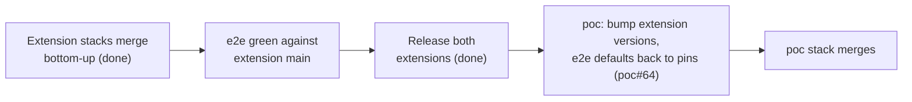

# Traceability Matrix

Links every script beat to its requirements, use cases, test cases and the
GitHub issues that implement them. When any of these changes, update this
file in the same change.

Issue refs: `OTelFeature/poc#N` (poc), `OTelFeature/otelfeature-instrument#N`
(Python), `OTelFeature/otelfeature-java-extension#N` (Java).

## Script beat → spec → issue

| Script beat | Requirements | Use case | Test case | Issues |
|---|---|---|---|---|
| Cold open: wall of spans (OTel Demo) | C-007 | UC-008 | TC-006 | OTelFeature/poc#33 |
| "Let me show you on something smaller" (transition to POC) | FR-018, FR-019 | UC-008 | TC-006 | OTelFeature/poc#24, OTelFeature/poc#26 |
| Demo 1: one flag turns OTel off, zero span ingest | FR-001, FR-002, FR-004, NFR-001, NFR-003, NFR-004, C-011 | UC-001 | TC-001 | OTelFeature/poc#8, OTelFeature/poc#9, OTelFeature/otelfeature-java-extension#21 |
| Demo 2: the SDK asks OpenFeature before the span exists | FR-006, FR-008, FR-023, C-004 | UC-002 | TC-002 | OTelFeature/otelfeature-java-extension#21, OTelFeature/otelfeature-instrument#14, OTelFeature/otelfeature-java-extension#27 |
| Demo 2: context = service name, instrumentation scope, the path | FR-005, C-003 | UC-002 | TC-002 | OTelFeature/poc#22, OTelFeature/otelfeature-instrument#7, OTelFeature/otelfeature-java-extension#20 |
| Demo 2: health checks off in one service, DB spans off in another | FR-006, FR-007, FR-023, NFR-007 | UC-002 | TC-002 | OTelFeature/otelfeature-instrument#7, OTelFeature/otelfeature-java-extension#20, OTelFeature/otelfeature-java-extension#21, OTelFeature/otelfeature-instrument#14, OTelFeature/otelfeature-java-extension#27, OTelFeature/poc#12 |
| Demo 2: CPU [X%], memory [Y MB], export bytes [Z%] | FR-016, NFR-005, NFR-006, NFR-011 | UC-003 | TC-003 | OTelFeature/poc#27 |
| Demo 3: rules on `service.name`, `deployment.environment.name` | FR-005, FR-010, FR-026 | UC-004 | TC-004 | OTelFeature/poc#25, OTelFeature/otelfeature-instrument#7, OTelFeature/otelfeature-java-extension#20, OTelFeature/poc#59 |
| Demo 3: sample rate as a number flag | FR-009, NFR-001, NFR-007, C-011, C-012 | UC-004 | TC-004 | OTelFeature/poc#10, OTelFeature/otelfeature-instrument#22 |
| Demo 3: errors rise, a rule turns sampling up for that service | FR-011, FR-012, FR-013, NFR-013, NFR-014, C-005 | UC-005, UC-006 | TC-005 | OTelFeature/poc#28, OTelFeature/otelfeature-instrument#8, OTelFeature/otelfeature-java-extension#22, OTelFeature/poc#29 |
| Demo 3: the flag explains itself (wording open, OQ-9) | FR-014, FR-015 | UC-007 | TC-005 | OTelFeature/poc#30, OTelFeature/otelfeature-instrument#9, OTelFeature/otelfeature-java-extension#23 |
| "Why not the collector?" (could read the same flags) | C-010 | - | - | none (D4, script only) |
| CTA: repo and demo on the slide | FR-020, FR-021 | UC-009 | TC-007 | OTelFeature/poc#31, OTelFeature/poc#14 |
| Stage risk: live demo fails | C-008 | UC-008 | TC-006 | OTelFeature/poc#32 |
| Stage risk: a beat broke since the last rehearsal | NFR-004, NFR-012, NFR-015, NFR-016, C-013, C-014 | UC-008 (BR-005) | TC-001, TC-002, TC-004, TC-005, TC-006 (Automation sections) | OTelFeature/poc#35, OTelFeature/otelfeature-instrument#20, OTelFeature/otelfeature-java-extension#32, OTelFeature/poc#67 |
| Q&A: what else can become a flag | FR-021 | UC-009 | TC-007 | OTelFeature/poc#14, OTelFeature/poc#15 |

## Issue → spec

Priority as in `DEMO-BACKLOG.md`, updated with the 2026-10-16 changes that
moved OTelFeature/poc#23 and OTelFeature/poc#11 to P2 and added `recordSpan`,
the end-to-end suite and the toolchain images.

| Issue | Title (short) | Pri | Requirements | Use case | Test case |
|---|---|---|---|---|---|
| OTelFeature/poc#8 | `OFF` variant + `otelEnabled` | P0 | FR-001, FR-002, NFR-001 | UC-001 | TC-001 |
| OTelFeature/poc#9 | `TelemetryPolicy`, `OTEL_SDK_DISABLED` hard floor | P0 | FR-004, NFR-001, C-011 | UC-001, UC-002, UC-004 | TC-001 |
| OTelFeature/poc#10 | `traceSampleRatio` | P0 | FR-009, NFR-007, C-011, C-012 | UC-004, UC-005 | TC-001, TC-004 |
| OTelFeature/poc#11 | `signalsEnabled` (metrics/logs gating) | P2, out of scope | FR-022 | - | - |
| OTelFeature/poc#12 | Per-tracer scope decision (Python) | P1 | FR-007 | UC-002 (A2, BR-007) | TC-002 |
| OTelFeature/poc#14 | Env-var tier docs | P2 | FR-021 | UC-009 | TC-007 |
| OTelFeature/poc#15 | Roadmap | P2 | - | - | - |
| OTelFeature/poc#22 | Spike: dotted semconv keys | P0 | FR-005 | UC-002, UC-004 | TC-002 |
| OTelFeature/poc#23 | Noisy demo | P2, deferred | FR-017 | none | none |
| OTelFeature/poc#24 | Offline stage mode | P0 | FR-018, C-009 | UC-008, UC-009 | TC-006 |
| OTelFeature/poc#25 | Resource attrs, prod/staging | P0 | FR-010 | UC-004 | TC-004 |
| OTelFeature/poc#26 | Stage controls | P0 | FR-019 | UC-008 | TC-006 |
| OTelFeature/poc#27 | Measurement harness | P1 | FR-016, NFR-005, NFR-011 | UC-003 | TC-003 |
| OTelFeature/poc#28 | Fault-injection flag | P1 | FR-012 | UC-006 | TC-005 |
| OTelFeature/poc#29 | Control-loop preset | P1 | FR-013, NFR-012 | UC-005 | TC-005 |
| OTelFeature/poc#30 | OpenFeature OTel hooks in the apps | P1 | FR-015 | UC-007 | TC-005 |
| OTelFeature/poc#31 | Public repo | P1 | FR-020 | UC-009 | TC-007 |
| OTelFeature/poc#32 | Fallback video | P2 | C-008 | UC-008 | TC-006 |
| OTelFeature/poc#80 | Control loop e2e for the Python reader | P1 | FR-012, FR-013 | UC-005, UC-006 | TC-005 |
| OTelFeature/poc#33 | OTel Demo footage | P1 | C-007 | UC-008 | TC-006 |
| OTelFeature/poc#38 | k6 health-check scenario, split out of OTelFeature/poc#23 (answers OQ-5) | P0 | FR-006 (Demo 2 traffic) | UC-002 | TC-002 |
| OTelFeature/poc#59 | Cross-service path: `geocode` calls `weather` | P1 | FR-026 | UC-004 | TC-004 |
| OTelFeature/poc#35 | End-to-end suite in CI, safety net before merging | P1 | NFR-015, C-013 (verifies NFR-004, NFR-012) | UC-008 (BR-005) | TC-001, TC-002, TC-004, TC-005, TC-006 |
| OTelFeature/poc#64 | Pin released extensions (v0.3.0 / v0.4.0) for stage and e2e | P0 | C-006, C-013 | UC-008 | TC-006 |
| OTelFeature/otelfeature-instrument#7 | Eval context from semconv (Python) | P0 | FR-005, NFR-003 | UC-002, UC-004 | TC-002, TC-004 |
| OTelFeature/otelfeature-instrument#8 | Error rate into context (Python); also `OTEL_METRICS_EXPORTER=none` | P1 | FR-011, FR-024, NFR-013, NFR-014, C-005 | UC-005 | TC-005 |
| OTelFeature/otelfeature-instrument#9 | No decision attributes; opt-in tracing hook (Python) | P1 | FR-014, NFR-006 | UC-007 | TC-005 |
| OTelFeature/otelfeature-instrument#14 | `recordSpan` (Python) | P0 | FR-006, FR-007, FR-023 | UC-002 | TC-002 |
| OTelFeature/otelfeature-instrument#19 | `OTEL_TRACES_EXPORTER=none` (Python); a PR with no separate issue | - | FR-025 | none (SDK parity) | TC-001 |
| OTelFeature/otelfeature-instrument#20 | Toolchain image `ci/Dockerfile` and first test CI (Python) | P1 | NFR-016, C-014 | none (tooling) | none |
| OTelFeature/otelfeature-instrument#22 | Negative `traceSampleRatio` falls back, like Java (Python) | P1 | NFR-001, FR-009 | UC-004 (A1) | TC-004 |
| OTelFeature/otelfeature-java-extension#20 | Eval context from semconv (Java) | P0 | FR-005, NFR-003 | UC-002, UC-004 | TC-002, TC-004 |
| OTelFeature/otelfeature-java-extension#21 | `FlagAwareSampler`, switchable | P0 | FR-006, FR-008, C-004 | UC-001, UC-002, UC-003 | TC-001, TC-002, TC-003 |
| OTelFeature/otelfeature-java-extension#22 | Error rate into context (Java); also `OTEL_METRICS_EXPORTER=none` | P1 | FR-011, FR-024, NFR-013, NFR-014 | UC-005 | TC-005 |
| OTelFeature/otelfeature-java-extension#23 | Decision attributes (Java); closed as not planned 2026-10-16, the extension writes none (FR-014) | P1 | FR-014 | UC-007 | TC-005 |
| OTelFeature/otelfeature-java-extension#27 | `recordSpan` (Java) | P0 | FR-006, FR-007, FR-023, C-004 | UC-002 | TC-002 |
| OTelFeature/otelfeature-java-extension#32 | Toolchain image `ci/Dockerfile` (Java), also the e2e build stage | P1 | NFR-016, C-013, C-014 | none (tooling) | none |
| OTelFeature/poc#67 | Toolchain (`poc`): `make test`, `make shell`, base pinned by digest | P1 | NFR-016, C-014 | none (tooling) | none |
| OTelFeature/otelfeature-instrument#24 | Release v0.3.0 (release workflow, wheel + sdist); tagged and released 2026-10-16 | P0 | C-006 | UC-008 | TC-006 |
| OTelFeature/otelfeature-java-extension#37 | Release v0.4.0; tagged and released 2026-10-16 | P0 | C-006 | UC-008 | TC-006 |

## Execution lanes

One agent per lane can run concurrently; within a lane, go in order. Each
issue is one PR, stacked on the previous one in its lane (see the
[agent workflow](README.md#workflow-for-implementation-simon-2026-10-16)).

- **Python** (`otelfeature-instrument`, merged): poc#8 → poc#9 → instrument#7 → instrument#14 → poc#10 (py) → instrument#8 → instrument#9 → poc#12
- **Java** (`otelfeature-java-extension`, merged): poc#8 → poc#9 → java#21 → java#20 → java#27 → poc#10 (java) → java#22 (java#23 closed as not planned)
- **POC** (`poc`): poc#22 (done) → poc#24 → poc#25 → poc#38 → poc#26 → poc#28 → poc#30 → poc#27 → poc#29 → poc#59 → poc#31
- **E2E** (`poc`): poc#35 in its five phases (harness, TC-001 and hard floors, TC-002, TC-004 and TC-005, matrix and nightly). Each phase starts once the POC-lane issues and extension code it needs exist.
- **Toolchain** (not stacked, each its own PR from `main`): instrument#20 (PR #21), java#32 (PR #35), poc#67 (PR #69). They depend on nothing in the feature stacks; once merged, a rebased stacked PR gets a CI run.
- **People, not agents:** poc#33, poc#32

Sync points: poc#22 finishes before instrument#7 / java#20 start. poc#27
decides D3 once java#21 is released. poc#27's final numbers and poc#29 need
released versions of both extensions (C-006); both are released
(otelfeature-instrument v0.3.0, otelfeature-java-extension v0.4.0) and pinned
by poc#64, and poc#35 runs against those pins by default (C-013). The `traceSampleRatio` entry in
`src/flagd/flagd.json` (poc#10) is a `poc` change, not part of the extension
PRs.

## Implementation

State as of 2026-10-16, checked with `gh` and
`git merge-base --is-ancestor <head> origin/main`. Both extension chains are
**merged on `main`** and released as otelfeature-instrument v0.3.0 and
otelfeature-java-extension v0.4.0; `poc` pins them (OTelFeature/poc#64, C-006). The toolchain PRs are
merged. The POC section below was not rechecked: its stack #36–#43 has
since merged.

### Python (`OTelFeature/otelfeature-instrument`): merged

Every PR below is on `main`. All but #15 were merged into `main` directly;
#15 was merged into `feat/sample-ratio` and reached `main` with #13.

| PR | Issue (state) | Requirements | Use case | Test case |
|---|---|---|---|---|
| OTelFeature/otelfeature-instrument#10 | OTelFeature/poc#8 (closed) | FR-001, FR-002 | UC-001 | TC-001 |
| OTelFeature/otelfeature-instrument#11 | OTelFeature/poc#9 (closed) | FR-004, NFR-001, C-011 | UC-001, UC-002, UC-004 | TC-001 |
| OTelFeature/otelfeature-instrument#12 | OTelFeature/otelfeature-instrument#7 (closed) | FR-005, NFR-003 | UC-002, UC-004 | TC-002, TC-004 |
| OTelFeature/otelfeature-instrument#18 | OTelFeature/otelfeature-instrument#14 (closed) | FR-006, FR-007, FR-023 | UC-002 | TC-002 |
| OTelFeature/otelfeature-instrument#13 | OTelFeature/poc#10, Python half (closed) | FR-009, C-011, C-012 | UC-004 | TC-004 |
| OTelFeature/otelfeature-instrument#15 (via #13) | OTelFeature/otelfeature-instrument#8 (closed) | FR-011, FR-024, NFR-013, NFR-014, C-005 | UC-005 | TC-005 |
| OTelFeature/otelfeature-instrument#16 | OTelFeature/otelfeature-instrument#9 (closed) | FR-014, NFR-006 | UC-007 | TC-005 |
| OTelFeature/otelfeature-instrument#17 | OTelFeature/poc#12, Python half (closed) | FR-007 | UC-002 | TC-002 |
| OTelFeature/otelfeature-instrument#19 | none (parity request) | FR-025 | none | TC-001 |
| OTelFeature/otelfeature-instrument#23 | OTelFeature/otelfeature-instrument#22 (closed) | NFR-001, FR-009 | UC-004 (A1) | TC-004 |

### Java (`OTelFeature/otelfeature-java-extension`): merged

#24 was merged into `main` directly. #25 ← #26 ← #28 ← #29 ← #30 ← #31 were
each merged into their stack base and then landed on `main` together through
**landing PR OTelFeature/otelfeature-java-extension#33** (merge `ad9297b`).

| PR | Issue (state) | Requirements | Use case | Test case |
|---|---|---|---|---|
| OTelFeature/otelfeature-java-extension#24 | OTelFeature/poc#8 (closed) | FR-001, FR-002 | UC-001 | TC-001 |
| OTelFeature/otelfeature-java-extension#25 (via #33) | OTelFeature/poc#9 (closed) | FR-004, NFR-001, C-011 | UC-001, UC-002, UC-004 | TC-001 |
| OTelFeature/otelfeature-java-extension#26 (via #33) | OTelFeature/otelfeature-java-extension#21 (closed) | FR-006, FR-008, C-004 | UC-001, UC-002, UC-003 | TC-001, TC-002, TC-003 |
| OTelFeature/otelfeature-java-extension#28 (via #33) | OTelFeature/otelfeature-java-extension#20 (closed) | FR-005, NFR-003 | UC-002, UC-004 | TC-002, TC-004 |
| OTelFeature/otelfeature-java-extension#29 (via #33) | OTelFeature/otelfeature-java-extension#27 (closed) | FR-006, FR-007, FR-023, C-004 | UC-002 | TC-002 |
| OTelFeature/otelfeature-java-extension#30 (via #33) | OTelFeature/poc#10, Java half (closed) | FR-009, C-011 | UC-004 | TC-004 |
| OTelFeature/otelfeature-java-extension#31 (via #33) | OTelFeature/otelfeature-java-extension#22 (closed) | FR-011, FR-024, NFR-013, NFR-014 | UC-005 | TC-005 |

`OTEL_TRACES_EXPORTER=none` (FR-025) needs no Java PR: SDK autoconfigure
already honours it.

OTelFeature/otelfeature-java-extension#23 was closed as not planned
(2026-10-16): the extension writes no decision attributes (FR-014), so
nothing was left in scope. A Java opt-in tracing hook would be a new issue.

### POC (`OTelFeature/poc`): open stack

`main` ← #36 ← #37 ← #40 ← #41 ← #42 ← #43. All open.

| PR | Issue | Requirements | Use case | Test case |
|---|---|---|---|---|
| OTelFeature/poc#36 | OTelFeature/poc#24 | FR-018, C-009 | UC-008, UC-009 | TC-006 |
| OTelFeature/poc#37 | OTelFeature/poc#25 | FR-010 | UC-004 | TC-004 |
| OTelFeature/poc#40 | OTelFeature/poc#38 (answers OQ-5) | FR-006 (traffic for Demo 2) | UC-002 | TC-002 |
| OTelFeature/poc#41 | OTelFeature/poc#26 | FR-019, NFR-004 | UC-008 | TC-006 |
| OTelFeature/poc#42 | OTelFeature/poc#28 | FR-012 | UC-006 | TC-005 |
| OTelFeature/poc#43 | OTelFeature/poc#35, phase 1 | NFR-015, C-013 | UC-008 (BR-005) | TC-006 |
| OTelFeature/poc#82 | OTelFeature/poc#80 | FR-012 | UC-005, UC-006 | TC-005 |

PR #41 still has one `03-semconv-rules` preset that resets `recordSpan`, and
PR #42 builds `03b-incident` on it. Both follow the cumulative-preset
decision ([entity model](entity_model.md#flag_preset), UC-008 BR-006) before
they merge.

Next `poc` items after this stack, in lane order: OTelFeature/poc#30 (hooks
in the apps), OTelFeature/poc#27 (measurements, decides OQ-1),
OTelFeature/poc#29 (control-loop preset), OTelFeature/poc#31 (public repo),
and the remaining phases of OTelFeature/poc#35. The `poc` version bump to
the released extensions (C-006) is OTelFeature/poc#64: the stage and the e2e
defaults run otelfeature-instrument v0.3.0 and otelfeature-java-extension
v0.4.0; a git ref is built only when passed explicitly (C-013).

C-013 is Implemented with OTelFeature/poc#64 (set by hand, no use case links
it; Simon's status rule, 2026-10-16). C-006 stays Open: its only linking use
case, UC-003, is still Draft.

Closed `poc` issues: #8, #9, #10, #12 (both halves landed), #22 (spike done).

### Toolchain

Not stacked; each is its own PR from `main`.

| Issue | PR | Requirements | State |
|---|---|---|---|
| OTelFeature/otelfeature-instrument#20 | OTelFeature/otelfeature-instrument#21 | NFR-016, C-014 | merged 2026-10-16 |
| OTelFeature/otelfeature-java-extension#32 | OTelFeature/otelfeature-java-extension#35 | NFR-016, C-013, C-014 | merged 2026-10-16 |

| OTelFeature/poc#67 | OTelFeature/poc#69 | NFR-016, C-014 | merged 2026-10-16 |

NFR-016 and C-014 are Implemented (set by hand, no use case links them):
OTelFeature/poc#69 is merged, so all three repos have a
`ci/Dockerfile` pinned by tag and digest, `make test` and `make shell` in
it (in `poc` also `make e2e`), image-based CI (no `setup-python`,
`setup-java` or `setup-uv`), Dependabot on `/ci`, and LF enforced in
`.gitattributes`. In `poc`, `make test` runs the stack-free preset checks
(flagd schema, baseline, `src/flagd/test_presets.py`); `make spec-lint`
runs in its own digest-pinned `python` image, also Docker only.

### Merge lessons

From merging the extension chains (the workflow rule is in `AGENTS.md`,
workflow step 4):

- A stacked PR merged into a **non-`main` base** does not reach `main` and
  does not auto-close its issue. The Java chain needed landing PR #33; check
  each issue afterwards and close the ones that stayed open.
- Both extension repos auto-delete head branches. `gh pr merge
  --delete-branch` (an API branch delete) **closes** the dependent PRs
  instead of retargeting them. Retarget the next PR to `main` before merging,
  merge bottom-up, then check every head with
  `git merge-base --is-ancestor <head> origin/main`.

## Merge order

Decided by Simon, 2026-10-16 (C-013). Steps 1 to 3 are done: both extension
chains are on `main` and released. The end-to-end suite (OTelFeature/poc#35)
did not exist yet when they merged, so it ran against each extension's `main`
until the releases; step 4 (OTelFeature/poc#64) switches its defaults to the
pinned releases.

1. The extension stacks merged bottom-up: Python #10 → … → #19, Java #24,
   then #25 → … → #31 via #33. A person merges and retargets; agents never
   merge.
2. The suite is green against the extension `main` branches, in both Java
   enforcement modes.
3. Both extensions are released (Simon, 2026-10-16): otelfeature-instrument
   v0.3.0 (OTelFeature/otelfeature-instrument#24, adds a release workflow) and
   otelfeature-java-extension v0.4.0 (OTelFeature/otelfeature-java-extension#37),
   as GitHub Releases created by a `v*` tag. Done.
4. This step: `poc` pins the released versions for the stage and the e2e defaults
   (C-006, C-013, OTelFeature/poc#64). Git refs stay only as an explicit e2e
   input; the stage never builds from git (OTelFeature/poc#58 closed). The
   suite must be green on the bump in both Java enforcement modes.
5. The `poc` stack (#36 ← … ← #44) already merged, before the releases, with
   the suite green against the extension `main` branches.

The toolchain PRs (OTelFeature/otelfeature-instrument#21,
OTelFeature/otelfeature-java-extension#35) are independent of this order.

## Requirements without a use case

| Requirement | Why |
|---|---|
| FR-003 | Existing behaviour (`telemetryLevel=IO`), kept as is; covered by the extensions' existing tests |
| FR-017 | Deferred with OTelFeature/poc#23 |
| FR-022 | Deferred with OTelFeature/poc#11 |
| NFR-002, NFR-009, NFR-010 | Already met by the current code; regression-tested in the extension repos |
| FR-025 | SDK parity for `OTEL_TRACES_EXPORTER=none`; no demo beat uses it. Checked in TC-001 item 10 |
| NFR-016, C-013, C-014 | How the code is built, tested and merged, not what the demo does |
