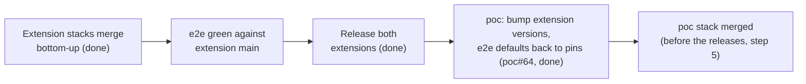

# Traceability Matrix

Links every script beat to its requirements, use cases, test cases and the
GitHub issues that implement them. When any of these changes, update this
file in the same change.

Issue refs: `OTelFeature/poc#N` (poc), `OTelFeature/otelfeature-instrument#N`
(Python), `OTelFeature/otelfeature-java-extension#N` (Java).

## Script beat → spec → issue

| Script beat | Requirements | Use case | Test case | Issues |
|---|---|---|---|---|
| Cold open: wall of spans (OTel Demo) | C-007 | UC-008 | TC-006 | OTelFeature/poc#33 |
| "Let me show you on something smaller" (transition to POC) | FR-018, FR-019, NFR-017 | UC-008 | TC-006 | OTelFeature/poc#24, OTelFeature/poc#26, OTelFeature/poc#91 |
| Demo 1: one flag turns OTel off, zero span ingest | FR-001, FR-002, FR-004, NFR-001, NFR-003, NFR-004, C-011 | UC-001 | TC-001 | OTelFeature/poc#8, OTelFeature/poc#9, OTelFeature/otelfeature-java-extension#21 |
| Demo 2: the SDK asks OpenFeature before the span exists | FR-006, FR-008, FR-023, C-004 | UC-002 | TC-002 | OTelFeature/otelfeature-java-extension#21, OTelFeature/otelfeature-instrument#14, OTelFeature/otelfeature-java-extension#27 |
| Demo 2: context = service name, instrumentation scope, the path | FR-005, C-003 | UC-002 | TC-002 | OTelFeature/poc#22, OTelFeature/otelfeature-instrument#7, OTelFeature/otelfeature-java-extension#20 |
| Demo 2: health checks off in one service, DB spans off in another | FR-006, FR-007, FR-023, NFR-007 | UC-002 | TC-002 | OTelFeature/otelfeature-instrument#7, OTelFeature/otelfeature-java-extension#20, OTelFeature/otelfeature-java-extension#21, OTelFeature/otelfeature-instrument#14, OTelFeature/otelfeature-java-extension#27, OTelFeature/poc#12 |
| Demo 2: CPU [X%], memory [Y MB], export bytes [Z%] | FR-016, NFR-005, NFR-006, NFR-011 | UC-003 | TC-003 | OTelFeature/poc#27 |
| Demo 3: rules on `service.name`, `deployment.environment.name` | FR-005, FR-010, FR-026 | UC-004 | TC-004 | OTelFeature/poc#25, OTelFeature/otelfeature-instrument#7, OTelFeature/otelfeature-java-extension#20, OTelFeature/poc#59 |
| Demo 3: sample rate as a number flag | FR-009, NFR-001, NFR-007, C-011, C-012 | UC-004 | TC-004 | OTelFeature/poc#10, OTelFeature/otelfeature-instrument#22 |
| Demo 3: errors rise, a rule turns sampling up for that service | FR-011, FR-012, FR-013, NFR-013, NFR-014, C-005 | UC-005, UC-006 | TC-005 | OTelFeature/poc#28, OTelFeature/otelfeature-instrument#8, OTelFeature/otelfeature-java-extension#22, OTelFeature/poc#29 |
| Demo 3: the flag explains itself (wording open, OQ-9) | FR-014, FR-015 | UC-007 | TC-005 | OTelFeature/poc#30, OTelFeature/otelfeature-instrument#9, OTelFeature/otelfeature-java-extension#23, OTelFeature/otelfeature-java-extension#39 |
| "Why not the collector?" (could read the same flags) | C-010 | - | - | none (D4, script only) |
| CTA: repo and demo on the slide | FR-020, FR-021, NFR-017 | UC-009 | TC-007 | OTelFeature/poc#31, OTelFeature/poc#14, OTelFeature/poc#91 |
| Stage risk: live demo fails | C-008 | UC-008 | TC-006 | OTelFeature/poc#32 |
| Stage risk: a beat broke since the last rehearsal | NFR-004, NFR-012, NFR-015, NFR-016, C-013, C-014 | UC-008 (BR-005) | TC-001, TC-002, TC-004, TC-005, TC-006 (Automation sections) | OTelFeature/poc#35, OTelFeature/otelfeature-instrument#20, OTelFeature/otelfeature-java-extension#32, OTelFeature/poc#67, OTelFeature/poc#70 |
| Q&A: what else can become a flag | FR-021 | UC-009 | TC-007 | OTelFeature/poc#14, OTelFeature/poc#15 |

## Issue → spec

Priority as in `DEMO-BACKLOG.md`, updated with the 2026-10-16 changes that
moved OTelFeature/poc#23 and OTelFeature/poc#11 to P2 and added `recordSpan`,
the end-to-end suite and the toolchain images.

| Issue | Title (short) | Pri | Requirements | Use case | Test case |
|---|---|---|---|---|---|
| OTelFeature/poc#8 | `OFF` variant + `otelEnabled` | P0 | FR-001, FR-002, NFR-001 | UC-001 | TC-001 |
| OTelFeature/poc#9 | `TelemetryPolicy`, `OTEL_SDK_DISABLED` hard floor | P0 | FR-004, NFR-001, C-011 | UC-001, UC-002, UC-004 | TC-001 |
| OTelFeature/poc#10 | `traceSampleRatio` | P0 | FR-009, NFR-007, C-011, C-012 | UC-004, UC-005 | TC-001, TC-004 |
| OTelFeature/poc#11 | `signalsEnabled` (metrics/logs gating); closed as not planned 2026-10-16 | P2, out of scope | FR-022 | - | - |
| OTelFeature/poc#12 | Per-tracer scope decision (Python) | P1 | FR-007 | UC-002 (A2, BR-007) | TC-002 |
| OTelFeature/poc#13 | Java extension on the flagd in-process resolver (same flip latency as Python); closed | P0 | C-002, NFR-002, NFR-004 | none (extension internals) | none |
| OTelFeature/poc#14 | Env-var tier docs | P2 | FR-021 | UC-009 | TC-007 |
| OTelFeature/poc#15 | Roadmap | P2 | - | - | - |
| OTelFeature/poc#22 | Spike: dotted semconv keys | P0 | FR-005 | UC-002, UC-004 | TC-002 |
| OTelFeature/poc#23 | Noisy demo | P2, deferred | FR-017 | none | none |
| OTelFeature/poc#24 | Offline stage mode | P0 | FR-018, C-009 | UC-008, UC-009 | TC-006 |
| OTelFeature/poc#25 | Resource attrs, prod/staging | P0 | FR-010 | UC-004 | TC-004 |
| OTelFeature/poc#26 | Stage controls | P0 | FR-019 | UC-008 | TC-006 |
| OTelFeature/poc#27 | Measurement harness | P1 | FR-016, NFR-005, NFR-011 | UC-003 | TC-003 |
| OTelFeature/poc#28 | Fault-injection flag | P1 | FR-012 | UC-006 | TC-005 |
| OTelFeature/poc#29 | Control-loop preset | P1 | FR-013, NFR-012 | UC-005 | TC-005 |
| OTelFeature/poc#30 | OpenFeature OTel hooks in the apps | P1 | FR-015 | UC-007 | TC-005 |
| OTelFeature/poc#31 | Public repo | P1 | FR-020 | UC-009 | TC-007 |
| OTelFeature/poc#32 | Fallback video | P2 | C-008 | UC-008 | TC-006 |
| OTelFeature/poc#33 | OTel Demo footage | P1 | C-007 | UC-008 | TC-006 |
| OTelFeature/poc#38 | k6 health-check scenario, split out of OTelFeature/poc#23 (answers OQ-5) | P0 | FR-006 (Demo 2 traffic) | UC-002 | TC-002 |
| OTelFeature/poc#59 | Cross-service path: `geocode` calls `weather` | P1 | FR-026 | UC-004 | TC-004 |
| OTelFeature/poc#35 | End-to-end suite in CI, safety net before merging | P1 | NFR-015, C-013 (verifies NFR-004, NFR-012) | UC-008 (BR-005) | TC-001, TC-002, TC-004, TC-005, TC-006 |
| OTelFeature/poc#64 | Pin released extensions (v0.3.0 / v0.4.0) for stage and e2e | P0 | C-006, C-013 | UC-008 | TC-006 |
| OTelFeature/otelfeature-instrument#7 | Eval context from semconv (Python) | P0 | FR-005, NFR-003 | UC-002, UC-004 | TC-002, TC-004 |
| OTelFeature/otelfeature-instrument#8 | Error rate into context (Python); also `OTEL_METRICS_EXPORTER=none` | P1 | FR-011, FR-024, NFR-013, NFR-014, C-005 | UC-005 | TC-005 |
| OTelFeature/otelfeature-instrument#9 | No decision attributes; opt-in tracing hook (Python) | P1 | FR-014, NFR-006 | UC-007 | TC-005 |
| OTelFeature/otelfeature-instrument#14 | `recordSpan` (Python) | P0 | FR-006, FR-007, FR-023 | UC-002 | TC-002 |
| OTelFeature/otelfeature-instrument#19 | `OTEL_TRACES_EXPORTER=none` (Python); a PR with no separate issue | - | FR-025 | none (SDK parity) | TC-001 |
| OTelFeature/otelfeature-instrument#20 | Toolchain image `ci/Dockerfile` and first test CI (Python) | P1 | NFR-016, C-014 | none (tooling) | none |
| OTelFeature/otelfeature-instrument#22 | Negative `traceSampleRatio` falls back, like Java (Python) | P1 | NFR-001, FR-009 | UC-004 (A1) | TC-004 |
| OTelFeature/otelfeature-java-extension#20 | Eval context from semconv (Java) | P0 | FR-005, NFR-003 | UC-002, UC-004 | TC-002, TC-004 |
| OTelFeature/otelfeature-java-extension#21 | `FlagAwareSampler`, switchable | P0 | FR-006, FR-008, C-004 | UC-001, UC-002, UC-003 | TC-001, TC-002, TC-003 |
| OTelFeature/otelfeature-java-extension#22 | Error rate into context (Java); also `OTEL_METRICS_EXPORTER=none` | P1 | FR-011, FR-024, NFR-013, NFR-014 | UC-005 | TC-005 |
| OTelFeature/otelfeature-java-extension#23 | Decision attributes (Java); closed as not planned 2026-10-16, the extension writes none (FR-014) | P1 | FR-014 | UC-007 | TC-005 |
| OTelFeature/otelfeature-java-extension#39 | Opt-in tracing hook for the extension's own evaluations (Java, parity with Python); `main` only, no release before the talk | P2 | FR-014, NFR-006 | UC-007 (BR-002) | TC-005 (item 10, unit tests) |
| OTelFeature/otelfeature-java-extension#27 | `recordSpan` (Java) | P0 | FR-006, FR-007, FR-023, C-004 | UC-002 | TC-002 |
| OTelFeature/otelfeature-java-extension#32 | Toolchain image `ci/Dockerfile` (Java), also the e2e build stage | P1 | NFR-016, C-013, C-014 | none (tooling) | none |
| OTelFeature/poc#67 | Toolchain (`poc`): `make test`, `make shell`, base pinned by digest | P1 | NFR-016, C-014 | none (tooling) | none |
| OTelFeature/poc#74 | Full stage rehearsal three times, offline, on the pinned releases (people: Simon and Juliano) | P1 | NFR-012, FR-018, C-006 | UC-008 | TC-006 |
| OTelFeature/poc#75 | Unit test for the `FaultInjection` bounds | P2 | FR-012 | UC-006 (BR-002) | TC-005 (item 7) |
| OTelFeature/poc#80 | Python parity in e2e: fault injection in `geocode`, clearer job names | P1 | FR-012, FR-013, FR-015, NFR-015 | UC-005, UC-006 (A3), UC-007 (A2) | TC-005 |
| OTelFeature/poc#91 | Prebuilt multi-arch images from `main`; Docker is the only dependency (`flag` compose service) | P1 | NFR-017, FR-019, FR-020, C-006 | UC-008 (BR-007, BR-008, A3), UC-009 (BR-001, A1) | TC-006, TC-007 |
| OTelFeature/poc#70 | Faster builds and e2e suite | P1 | NFR-015, NFR-016 | none (tooling) | TC-001, TC-002, TC-004, TC-005, TC-006 (Automation sections) |
| OTelFeature/otelfeature-instrument#24 | Release v0.3.0 (release workflow, wheel + sdist); tagged and released 2026-10-16 | P0 | C-006 | UC-008 | TC-006 |
| OTelFeature/otelfeature-java-extension#37 | Release v0.4.0; tagged and released 2026-10-16 | P0 | C-006 | UC-008 | TC-006 |

## Execution lanes

One agent per lane can run concurrently; within a lane, go in order. Each
issue is one PR, stacked on the previous one in its lane (see the
[agent workflow](README.md#workflow-for-implementation-simon-2026-10-16)).

- **Python** (`otelfeature-instrument`, merged): poc#8 → poc#9 → instrument#7 → instrument#14 → poc#10 (py) → instrument#8 → instrument#9 → poc#12
- **Java** (`otelfeature-java-extension`, merged): poc#8 → poc#9 → java#21 → java#20 → java#27 → poc#10 (java) → java#22 (java#23 closed as not planned); post-talk: java#39 (opt-in tracing hook, `main` only)
- **POC** (`poc`): poc#22 → poc#24 → poc#25 → poc#38 → poc#26 → poc#28 → poc#30 → poc#29 → poc#59 (all done) → poc#27 → poc#31
- **E2E** (`poc`): poc#35 in its five phases (harness, TC-001 and hard floors, TC-002, TC-004 and TC-005, matrix and nightly), all merged; the issue stays open until the nightly runs are green. Follow-ups: poc#70, poc#80.
- **Toolchain** (not stacked, each its own PR from `main`): instrument#20 (PR #21), java#32 (PR #35), poc#67 (PR #69). They depend on nothing in the feature stacks; once merged, a rebased stacked PR gets a CI run.
- **People, not agents:** poc#33, poc#32

Sync points: poc#22 finishes before instrument#7 / java#20 start. poc#27
decided D3 (`processor`, 2026-10-16). poc#27's final numbers and poc#29 need
released versions of both extensions (C-006); both are released
(otelfeature-instrument v0.3.0, otelfeature-java-extension v0.4.0) and pinned
by poc#64, and poc#35 runs against those pins by default (C-013). The `traceSampleRatio` entry in
`src/flagd/flagd.json` (poc#10) is a `poc` change, not part of the extension
PRs.

## Implementation

State as of 2026-10-16, checked with `gh` and
`git merge-base --is-ancestor <head> origin/main`. Both extension chains are
**merged on `main`** and released as otelfeature-instrument v0.3.0 and
otelfeature-java-extension v0.4.0; `poc` pins them (OTelFeature/poc#64, C-006). The toolchain PRs are
merged, and so is the whole `poc` stack (rechecked for OTelFeature/poc#73).

### Python (`OTelFeature/otelfeature-instrument`): merged

Every PR below is on `main`. All but #15 were merged into `main` directly;
#15 was merged into `feat/sample-ratio` and reached `main` with #13.

| PR | Issue (state) | Requirements | Use case | Test case |
|---|---|---|---|---|
| OTelFeature/otelfeature-instrument#10 | OTelFeature/poc#8 (closed) | FR-001, FR-002 | UC-001 | TC-001 |
| OTelFeature/otelfeature-instrument#11 | OTelFeature/poc#9 (closed) | FR-004, NFR-001, C-011 | UC-001, UC-002, UC-004 | TC-001 |
| OTelFeature/otelfeature-instrument#12 | OTelFeature/otelfeature-instrument#7 (closed) | FR-005, NFR-003 | UC-002, UC-004 | TC-002, TC-004 |
| OTelFeature/otelfeature-instrument#18 | OTelFeature/otelfeature-instrument#14 (closed) | FR-006, FR-007, FR-023 | UC-002 | TC-002 |
| OTelFeature/otelfeature-instrument#13 | OTelFeature/poc#10, Python half (closed) | FR-009, C-011, C-012 | UC-004 | TC-004 |
| OTelFeature/otelfeature-instrument#15 (via #13) | OTelFeature/otelfeature-instrument#8 (closed) | FR-011, FR-024, NFR-013, NFR-014, C-005 | UC-005 | TC-005 |
| OTelFeature/otelfeature-instrument#16 | OTelFeature/otelfeature-instrument#9 (closed) | FR-014, NFR-006 | UC-007 | TC-005 |
| OTelFeature/otelfeature-instrument#17 | OTelFeature/poc#12, Python half (closed) | FR-007 | UC-002 | TC-002 |
| OTelFeature/otelfeature-instrument#19 | none (parity request) | FR-025 | none | TC-001 |
| OTelFeature/otelfeature-instrument#23 | OTelFeature/otelfeature-instrument#22 (closed) | NFR-001, FR-009 | UC-004 (A1) | TC-004 |

### Java (`OTelFeature/otelfeature-java-extension`): merged

#24 was merged into `main` directly. #25 ← #26 ← #28 ← #29 ← #30 ← #31 were
each merged into their stack base and then landed on `main` together through
**landing PR OTelFeature/otelfeature-java-extension#33** (merge `ad9297b`).

| PR | Issue (state) | Requirements | Use case | Test case |
|---|---|---|---|---|
| OTelFeature/otelfeature-java-extension#24 | OTelFeature/poc#8 (closed) | FR-001, FR-002 | UC-001 | TC-001 |
| OTelFeature/otelfeature-java-extension#25 (via #33) | OTelFeature/poc#9 (closed) | FR-004, NFR-001, C-011 | UC-001, UC-002, UC-004 | TC-001 |
| OTelFeature/otelfeature-java-extension#26 (via #33) | OTelFeature/otelfeature-java-extension#21 (closed) | FR-006, FR-008, C-004 | UC-001, UC-002, UC-003 | TC-001, TC-002, TC-003 |
| OTelFeature/otelfeature-java-extension#28 (via #33) | OTelFeature/otelfeature-java-extension#20 (closed) | FR-005, NFR-003 | UC-002, UC-004 | TC-002, TC-004 |
| OTelFeature/otelfeature-java-extension#29 (via #33) | OTelFeature/otelfeature-java-extension#27 (closed) | FR-006, FR-007, FR-023, C-004 | UC-002 | TC-002 |
| OTelFeature/otelfeature-java-extension#30 (via #33) | OTelFeature/poc#10, Java half (closed) | FR-009, C-011 | UC-004 | TC-004 |
| OTelFeature/otelfeature-java-extension#31 (via #33) | OTelFeature/otelfeature-java-extension#22 (closed) | FR-011, FR-024, NFR-013, NFR-014 | UC-005 | TC-005 |

`OTEL_TRACES_EXPORTER=none` (FR-025) needs no Java PR: SDK autoconfigure
already honours it.

OTelFeature/otelfeature-java-extension#23 was closed as not planned
(2026-10-16): the extension writes no decision attributes (FR-014), so
nothing was left in scope. The Java opt-in tracing hook is OTelFeature/otelfeature-java-extension#39
(P2, open): it lands on `main` only, after v0.4.0, so the pinned stage does
not have it.

### POC (`OTelFeature/poc`): merged

Every PR below is on `main`. The first stack (#36 ← #37 ← #40 ← #41 ← #42 ←
#43) and the e2e phases merged bottom-up; the later PRs were merged into
`main` directly. Spec-only PRs are not listed.

| PR | Issue (state) | Requirements | Use case | Test case |
|---|---|---|---|---|
| OTelFeature/poc#36 | OTelFeature/poc#24 (closed) | FR-018, C-009 | UC-008, UC-009 | TC-006 |
| OTelFeature/poc#37 | OTelFeature/poc#25 (closed) | FR-010 | UC-004 | TC-004 |
| OTelFeature/poc#40 | OTelFeature/poc#38 (closed, answers OQ-5) | FR-006 (traffic for Demo 2), FR-017 (health-check part) | UC-002 | TC-002 |
| OTelFeature/poc#41 | OTelFeature/poc#26 (closed) | FR-019, NFR-004 | UC-008 | TC-006 |
| OTelFeature/poc#42 | OTelFeature/poc#28 (closed) | FR-012 | UC-006 | TC-005 |
| OTelFeature/poc#43, #44, #52, #53, #54, #57 | OTelFeature/poc#35, phases 1 to 5 and the TC-006 stage progression (#57) (open: the nightly flake check has not run yet) | NFR-015, C-013 | UC-008 (BR-005) | TC-001, TC-002, TC-004, TC-005, TC-006 |
| OTelFeature/poc#56 | OTelFeature/poc#29 (closed) | FR-013, NFR-012 | UC-005, UC-008 (BR-006) | TC-005, TC-006 |
| OTelFeature/poc#68 | none (OQ-14: incident share 0.5) | FR-012, FR-013 | UC-005, UC-006 (BR-003) | TC-005 |
| OTelFeature/poc#71 | OTelFeature/poc#59 (closed) | FR-026 | UC-004, UC-005 (A7) | TC-004 |
| OTelFeature/poc#77 | OTelFeature/poc#64 (closed) | C-006, C-013 | UC-008 | TC-006 |
| OTelFeature/poc#78 | OTelFeature/poc#30 (closed, answers OQ-4) | FR-014, FR-015 | UC-007 | TC-005 |
| OTelFeature/poc#79 | OTelFeature/poc#27 (numbers posted; OQ-1 decided `processor`, OQ-3 deferred, OQ-15 answered in PR OTelFeature/poc#85) | FR-016, NFR-005, NFR-011 | UC-003 | TC-003 |
| OTelFeature/poc#63 | none (spec loop for instrument#21 and #23) | NFR-016, NFR-001 | UC-004 (A1) | TC-004 |
| OTelFeature/poc#82 | OTelFeature/poc#80 | FR-012 | UC-005, UC-006 | TC-005 |
| OTelFeature/poc#88 | OTelFeature/poc#75 | FR-012 | UC-006 (BR-002, A1 to A3) | TC-005 (item 7) |
| OTelFeature/poc#89 | OTelFeature/poc#14 | FR-021 | UC-009 (BR-003) | TC-007 (item 2) |
| OTelFeature/poc#92 | OTelFeature/poc#91 (closed) | NFR-017, FR-019, FR-020, C-006 | UC-008 (BR-007, BR-008, A3), UC-009 (BR-001, A1) | TC-006, TC-007 |

PR OTelFeature/poc#58 (stage stack from git refs, FR-027) was closed
unmerged, and OTelFeature/poc#61 as not planned: the stage runs released
extensions only (C-006).

Open `poc` items, in lane order: OTelFeature/poc#27 (measurements: harness
merged with PR OTelFeature/poc#79, numbers posted, OQ-1 decided: `processor`), OTelFeature/poc#31 (public repo),
OTelFeature/poc#70 (faster builds and e2e), OTelFeature/poc#80 (Python
parity in e2e),
OTelFeature/poc#76 (`geocode` on Python 3.15: blocked, because
`openfeature-provider-flagd` requires `cachebox<6` and cachebox 5 has no
3.15 build; `geocode` stays on 3.14 and Dependabot ignores 3.15 until then,
decided by Simon, 2026-10-16), and OTelFeature/poc#35 until its nightly runs are green.
People, not agents: OTelFeature/poc#74 (full stage rehearsal three times,
offline, NFR-012), OTelFeature/poc#32 (fallback videos),
OTelFeature/poc#33 (OTel Demo footage).

C-013 is Implemented with OTelFeature/poc#64 (set by hand, no use case links
it). C-006 stays Open: both linking use cases, UC-003 (measurements,
OTelFeature/poc#27) and UC-008 (fallback videos and footage), are still
Draft. NFR-015 reads Open for the same reason: its only linking use case is
UC-008, although the suite exists and is green on `main`.

NFR-017 stays Open for the same reason: both linking use cases are Draft,
UC-008 for the fallback videos, the footage and the rehearsals, UC-009 for
the public repository (OTelFeature/poc#31), and TC-007 is a manual check.
What PR OTelFeature/poc#92 built is on `main` and works: the merge
(`e29c7a7`) published `ghcr.io/otelfeature/poc-geocode`, `poc-weather` and
`poc-stub-apis` as `main` and `sha-e29c7a7` for `linux/amd64` and
`linux/arm64`. Before the merge, Simon pulled the branch's images in WSL with
Docker only (`docker compose pull`, `docker compose up -d --pull never
--no-build`, the presets through the `flag` service, traces in Aspire;
2026-10-16). TC-007 can pass only after OTelFeature/poc#31, once the
packages are public as well.

Closed `poc` issues: #8, #9, #10, #12 (both halves landed), #13 (Java on the
flagd in-process resolver), #22 (spike done), #24, #25, #26, #28, #29, #30,
#38, #59, #64, #67, #91; #11 and #61 closed as not planned.

### Use case and test case status

Set by the Tested/Passed rule ([requirements.md](requirements.md), Simon,
2026-10-16, OTelFeature/poc#73), against the green `e2e` run on `main` at
`134a8b9` (both Java modes, 12 checks passed; the `slow` check deselected).

| Use case | Before | After | Why |
|---|---|---|---|
| UC-001 | Tested | Tested | TC-001 green |
| UC-002 | Implemented | Tested | TC-002 green |
| UC-003 | Draft | Draft | harness merged (PR OTelFeature/poc#79), OTelFeature/poc#27 open; TC-003 is not automated |
| UC-004 | Draft | Implemented | flows on `main` (#37, #71); TC-004's `slow` check has not run in a nightly yet |
| UC-005 | Draft | Tested | TC-005 green (#56, #68) |
| UC-006 | Implemented | Tested | TC-005 and TC-006 green |
| UC-007 | Draft | Tested | TC-005 green, with the hook check (#78) |
| UC-008 | Draft | Draft | TC-006 green, but the fallback videos and the footage (precondition, A1, C-007, C-008; OTelFeature/poc#32, OTelFeature/poc#33) don't exist yet, and the rehearsal runs (NFR-012, OTelFeature/poc#74) are open |
| UC-009 | Draft | Draft | OTelFeature/poc#31 open; TC-007 is not automated |

| Test case | Before | After |
|---|---|---|
| TC-001, TC-002, TC-005, TC-006 | Draft | Passed |
| TC-004 | Draft | Draft (Passed once a nightly run with `test_tc004_stage_preset_ratio` is green) |
| TC-003, TC-007 | Draft | Draft (not automated) |

### Toolchain

Not stacked; each is its own PR from `main`.

| Issue | PR | Requirements | State |
|---|---|---|---|
| OTelFeature/otelfeature-instrument#20 | OTelFeature/otelfeature-instrument#21 | NFR-016, C-014 | merged 2026-10-16 |
| OTelFeature/otelfeature-java-extension#32 | OTelFeature/otelfeature-java-extension#35 | NFR-016, C-013, C-014 | merged 2026-10-16 |
| OTelFeature/poc#67 | OTelFeature/poc#69 | NFR-016, C-014 | merged 2026-10-16 |

NFR-016 and C-014 are Implemented (set by hand, no use case links them):
OTelFeature/poc#69 is merged, so all three repos have a
`ci/Dockerfile` pinned by tag and digest, `make test` and `make shell` in
it (in `poc` also `make e2e`), image-based CI (no `setup-python`,
`setup-java` or `setup-uv`), Dependabot on `/ci`, and LF enforced in
`.gitattributes`. In `poc`, `make test` runs the stack-free preset checks
(flagd schema, baseline, `src/flagd/test_presets.py`); `make spec-lint`
runs in its own digest-pinned `python` image, also Docker only.

### Merge lessons

From merging the extension chains (the workflow rule is in `AGENTS.md`,
workflow step 4):

- A stacked PR merged into a **non-`main` base** does not reach `main` and
  does not auto-close its issue. The Java chain needed landing PR #33; check
  each issue afterwards and close the ones that stayed open.
- Both extension repos auto-delete head branches. `gh pr merge
  --delete-branch` (an API branch delete) **closes** the dependent PRs
  instead of retargeting them. Retarget the next PR to `main` before merging,
  merge bottom-up, then check every head with
  `git merge-base --is-ancestor <head> origin/main`.

## Merge order

Decided by Simon, 2026-10-16 (C-013). All steps are done: both extension
chains are on `main` and released, and `poc` pins the releases. The end-to-end suite (OTelFeature/poc#35)
did not exist yet when they merged, so it ran against each extension's `main`
until the releases; step 4 (OTelFeature/poc#64, PR OTelFeature/poc#77) switched its
defaults to the pinned releases.

1. The extension stacks merged bottom-up: Python #10 → … → #19, Java #24,
   then #25 → … → #31 via #33. A person merges and retargets; agents never
   merge.
2. The suite is green against the extension `main` branches, in both Java
   enforcement modes.
3. Both extensions are released (Simon, 2026-10-16): otelfeature-instrument
   v0.3.0 (OTelFeature/otelfeature-instrument#24, adds a release workflow) and
   otelfeature-java-extension v0.4.0 (OTelFeature/otelfeature-java-extension#37),
   as GitHub Releases created by a `v*` tag. Done.
4. `poc` pins the released versions for the stage and the e2e defaults
   (C-006, C-013, OTelFeature/poc#64). Git refs stay only as an explicit e2e
   input; the stage never builds from git (OTelFeature/poc#58 closed). The
   suite was green on the bump in both Java enforcement modes (PR
   OTelFeature/poc#77, merged). Done.
5. The `poc` stack (#36 ← … ← #44) already merged, before the releases, with
   the suite green against the extension `main` branches.

The toolchain PRs (OTelFeature/otelfeature-instrument#21,
OTelFeature/otelfeature-java-extension#35) are independent of this order.

## Requirements without a use case

| Requirement | Why |
|---|---|
| FR-003 | Existing behaviour (`telemetryLevel=IO`), kept as is; covered by the extensions' existing tests |
| FR-017 | Deferred with OTelFeature/poc#23 |
| FR-022 | Deferred with OTelFeature/poc#11 |
| NFR-009, NFR-010, C-002 | Already met by the current code; regression-tested in the extension repos (NFR-002 was listed here too, but UC-002 links it) |
| FR-025 | SDK parity for `OTEL_TRACES_EXPORTER=none`; no demo beat uses it. Checked in TC-001 item 10 |
| NFR-016, C-013, C-014 | How the code is built, tested and merged, not what the demo does |
| C-010 | Met by building nothing in the collector (D4); a script line only |
