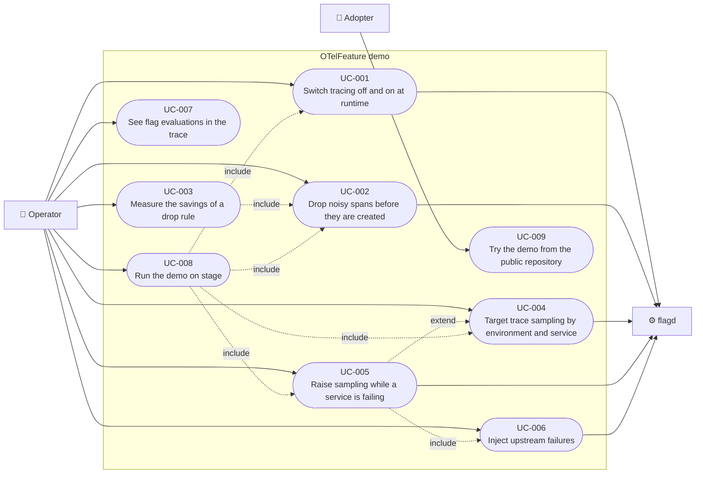

# Use case diagram

Mermaid has no use case diagram type, so this is a flowchart in use case
notation: actors on the outside, use cases as rounded nodes inside the system
boundary, solid arrows for participation, dotted arrows for `include` and
`extend`.

On stage, Simon and Juliano are the Operator and run the use cases through
flag presets (UC-008). There is no separate Speaker actor (Simon, 2026-10-16).
